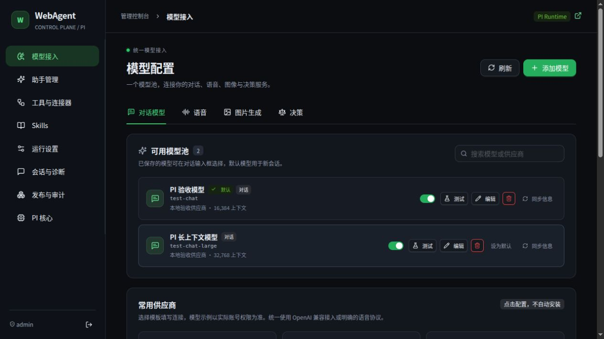
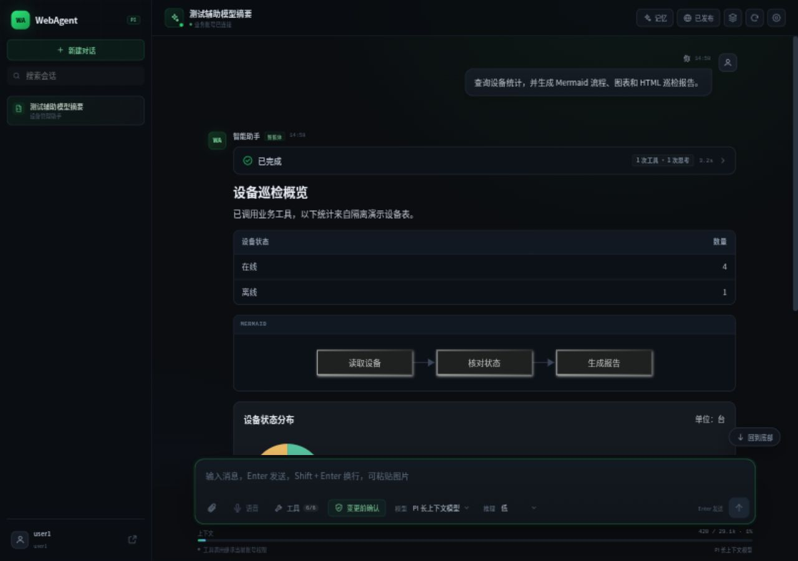
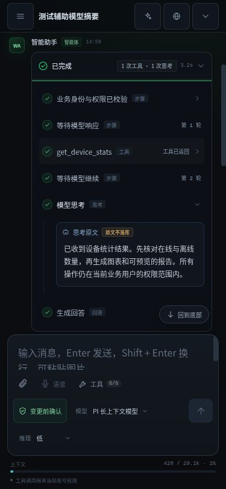

# WebAgent / PI

面向现有业务系统的 Agent 集成框架。用户在自己的业务权限内对话、查询数据、调用工具；框架管理员独立维护模型、助手、连接器、运行策略与诊断。

**此分支为 `WebAgent-PI`：Node.js / TypeScript 后端 + 官方 PI SDK，独立 React 管理端与 Chat 端。没有 Python 后端，也没有原生 HTML 版应用。**

运行时使用 [earendil-works/pi](https://github.com/earendil-works/pi)，当前三个核心依赖均精确锁定 `1.5.2`。PI 负责模型循环、流式事件、会话上下文、工具协议与压缩；WebAgent 负责身份、权限、审批、持久化和产品界面，不复制一套手写 Agent 循环。

## 三端结构

```text
admin/     React + Ant Design 管理端，独立登录与构建
chat/      React Chat 端，桌面与移动端响应式界面
server/    Fastify 后端、PI 适配、业务鉴权、工具、任务、SQLite 元数据
sdk/       TypeScript 客户端 SDK，支持注入业务 Token 与 fetch
deploy/    两个前端独立 Nginx 配置
scripts/   环境初始化与 PI 受控升级
docs/      架构、部署、模型、运行、业务接入、验收说明
```

根目录只保留工程入口和说明文档；本地运行数据与日志分别在 `data/`、`logs/`，均已被 Git 忽略，不会进入仓库。

管理端不是 Chat 端的管理模式。两者有各自入口、依赖、构建产物与 API 权限边界。便于本地体验时可以由同一个 Node 进程托管两个静态产物；Docker Compose 则分别部署三个服务。

## 快速启动

推荐 **Node.js 24 LTS**，最低 `22.19.0`。图片导出与录音重采样都在用户浏览器中完成；后端不依赖 Chromium 或 ffmpeg。

```bash
npm ci --registry=https://registry.npmjs.org
npm run init:env
npm run typecheck
npm test
npm run build
npm start
```

新环境随机生成不同的管理密码、业务管理员密码与加密密钥，写入本地 `.env`，不输出到终端。已有 `.env` 时脚本拒绝覆盖；从旧版迁移可运行 `npm run init:env -- --extend`，只补充缺失配置，不修改既有密钥、密码和其他配置。

| 入口 | 默认地址 | 身份 |
| --- | --- | --- |
| 管理端 | `http://127.0.0.1:8000/admin/` | 独立框架管理员 |
| Chat 端 | `http://127.0.0.1:8000/chat/` | 业务系统用户 |
| 后端健康检查 | `http://127.0.0.1:8000/health` | 无敏感信息 |

`/` 跳转 Chat；旧 `/react/` 仅跳转 `/chat/`，并没有第三套前端。Chat 在没有 `IdentityAdapter` 时必须用 `?token=` 接入 Token 打开。

管理账号 `admin` 的初始密码来自 `.env` 的 `WEBAGENT_CONTROL_PASSWORD`。管理端与业务端鉴权完全分离：管理端只认 `control_users` 与「管理 Token」，业务端只认 `IdentityAdapter` 或接入 Token。管理密码可在「PI 核心」页修改；环境变量只用于首次建号，不覆盖已保存密码。如果确实需要用环境变量恢复密码，把 `WEBAGENT_RESET_CONTROL_PASSWORD` 设为 `1` 重启一次（会覆盖 `admin` 密码并撤销所有管理会话），完成后再移除该变量，避免每次重启都覆盖后台改过的密码。

首次启动后，进入管理端配置供应商与真实对话模型，再设置默认助手。**没有模型配置就明确报错，不返回模拟答案。**

### 独立前端开发

分别打开终端：

```bash
npm run dev
npm run dev:admin
npm run dev:chat
```

- 后端：`8000`；管理端：`http://127.0.0.1:5174/admin/`；Chat：`http://127.0.0.1:5173/chat/`。
- 两个 Vite 服务代理同源 `/api`，不需要浏览器持有供应商 Key。
- 跨端跳转地址可在各前端目录的 `.env.local` 设置 `VITE_CHAT_URL`、`VITE_ADMIN_URL`；业务入口可用 `VITE_BUSINESS_URL`。

### Docker Compose

```bash
npm run init:env
docker compose config --quiet
docker compose up -d --build
```

管理端默认 `http://localhost:8081/admin/`，Chat 默认 `http://localhost:8080/chat/`，Node 后端只在内部网络暴露。三个服务分别构建，数据保存在命名卷。远程部署须配置公开前端 URL、HTTPS、独立管理密码，并接入业务身份适配器或签发接入 Token，详见 [部署说明](docs/DEPLOYMENT.md)。

## 主要能力

| 领域 | 当前实现 |
| --- | --- |
| 模型 | 对话 / 视觉 / STT / TTS / 生图 / 决策 / Embedding / Rerank 统一接入；多供应商、多连接、模型列表与元信息同步、分类真实测试 |
| 语音 | OpenAI STT / TTS、Chat Audio、DashScope ASR / TTS、实时 ASR WebSocket 适配；TTS 按句 / 长度增量送入，长段落不等待整段完成；普通识别默认只回填输入框，右上角提供 TTS 朗读与实时通话；未配置时禁用对应按钮 |
| 助手 | 默认助手、角色范围、绑定模型、允许切换、工具白名单、`skill_slugs` Skill 范围与预算；语音、TTS、推理强度、执行模式和运行预算均可助手级覆盖，留空继承全局 |
| 工具 | 开发注册原生函数、后台 HTTP API、MCP Streamable HTTP / SSE / stdio、表单与 JSON 导入；PI 本机执行工具默认关闭，可由部署者解锁后逐项管理 |
| 权限 | 继承当前业务身份；工具选择不等于授权；写入审批后重新鉴权；四态可见 / 可选策略 |
| 管理接入 | 独立管理端 Token，可把管理页面部署在业务系统或跨域调用 `/api/control`；支持过期、来源白名单、轮换与停用，不能访问 Chat 的 `/api/agent` |
| 筛选 | PI 原生 BM25 延迟工具发现、独立决策模型相关性评分；互斥且允许都关闭 |
| 交互 | `ask_user` 让模型在缺少信息时暂停，Chat 渲染单选 / 多选 / 补充文本问答卡；与危险操作审批卡严格分离 |
| 提示词 | 基础、压缩、标题、决策、记忆提取和附加系统提示词均可在管理端编辑并恢复默认 |
| Skill | 文件系统为唯一事实来源，支持全局 / 单项启停、助手级选择、ZIP / 目录导入；PI 原生渐进读取，正文不落数据库，不执行 Skill 脚本 |
| 会话 | 正文与 PI canonical entries 保存为 `data/sessions/<sessionId>.json`，图片附件保存到 `data/uploads/<sessionId>/`（JSON 只存相对路径）；SQLite 只保存归属、标题、用量与运行元数据。支持刷新恢复、分叉、编辑、删除、主动 / 手动压缩、分页检索与保留期清理 |
| 任务 | 后台运行独立于 SSE 连接，断开页面继续执行，重连回放，显式停止，重启不重放副作用 |
| 记忆 | 用户独立 CRUD、模型自动提取、默认待确认、管理员配置提取模型与规则 |
| Chat | Markdown、表格、KaTeX、Mermaid 与基础图表，单行实时过程、完成折叠、移动端弹窗 |
| HTML | 紧凑产物卡、滚动代码框、隔离预览、下载与浏览器端静态 PNG 导出，不把完整 HTML 铺在消息区 |
| PagePilot | 发布 / 更新、本地用户归属、内容版本与 URL 记录、手动可见范围和可空密码 |
| 运维 | 模型用途 / 耗时 / Token / 错误、决策短期输入输出诊断、会话审计、会话与发布记录检索、受控 PI 升级计划；启动时清理旧表 / 字段前自动备份 SQLite |

STT / TTS 的供应商原生协议不因「OpenAI 兼容」而自动相同，需选择正确模型类型与协议。自动推测仅为建议，以供应商实际权限和文档为准。

### 身份与账号

框架不再内置演示业务账号，也不创建演示业务库。业务身份只有两条来源：

1. 宿主系统通过 `IdentityAdapter.resolve()` 注入（推荐，可直接复用现有登录态与权限码）；
2. 管理端签发「接入 Token」，用 `/chat/?token=…` 打开匿名会话，Token 绑定助手、来源白名单、速率与保留期。

| 账号 | 来源 | 说明 |
| --- | --- | --- |
| `admin` | `.env` 的 `WEBAGENT_CONTROL_PASSWORD` | 仅用于管理端；业务账号永远不能进入管理端 |
| 业务用户 | 业务系统 | 由适配器返回 `subject` / `role` / `permissions`，框架不落库 |
| 匿名访客 | 接入 Token | 浏览器 Cookie 区分访客；同一浏览器刷新保持同一身份 |

## 接入业务系统

不强制 SSO，不强制 MCP，更不要求把整个业务系统改写为 Agent。建议优先复用现有业务服务：

1. Node 宿主直接嵌入 `createWebAgent()`，实现 `IdentityAdapter.resolve()`。
2. 用 `tools` 注册业务原生函数，函数内复用原业务授权与数据范围校验。
3. 非 Node 业务通过同源反向代理 + HTTP 工具或 MCP 接入。
4. 前端复用 `@webagent/sdk`，每次请求从宿主取得当前 Token；也可借鉴 Chat 组件自建界面。

如果管理端静态资源也部署在业务系统，可在「接入与安全 → 管理端 Token」签发独立 Token，再在管理端登录页选择「使用管理 Token 连接」。同源部署直接反代 `/api/control`；跨域部署填写完整 API 地址，并把管理端 Origin 加入 Token 白名单。管理 Token 只调用 `/api/control`，与 Chat 接入 Token、业务身份完全分离。

**框架管理员不自动获得业务权限，业务管理员也不自动获得框架配置权限。** 租户及行级权限应由业务适配器和业务服务最终实施，不能只依赖提示词、前端隐藏按钮或决策评分。

可运行的接口形态与完整示例见 [业务接入手册](docs/INTEGRATION.md)。当前没有内置租户知识库、任意脚本 Skill、PDF 解析沙箱；知识库可作为外部 Tool / MCP 接入。

## PI 升级

管理端「PI 核心」提供安装版本、官方版本检查与升级计划，不会在 HTTP 请求中执行 npm 或热替换核心。

```bash
npm run core:upgrade -- 1.5.2
npm run core:upgrade -- 1.5.2 --apply
```

`--apply` 需要先停后端；脚本备份数据库与依赖文件，同步三个 PI 包的精确版本，再执行类型检查、测试、构建。失败恢复依赖文件并尝试恢复安装。容器部署应在源码中升级、验证、重新构建镜像，而不是进入容器热升级。

## 验证与边界

```bash
npm run typecheck
npm test
npm run build
git diff --check
```

测试连接真实 PI SDK 和本地 Mock 上游，覆盖权限、审批、问答卡、断线续跑、上下文、工具筛选、语音、助手级配置覆盖、文件会话迁移、管理端 Token 与发布适配。当前自动回归为后端 57、SDK 4、Chat 28，共 89 项。**Mock 协议测试通过不代表所有真实供应商账号、地域、音色与模型权限都已验收。**

PI 官方 Bash / PowerShell、文件读写与 CodeMode 在管理端列出，默认 `WEBAGENT_LOCAL_TOOLS=off` 时锁定关闭。部署者显式设为 `WEBAGENT_LOCAL_TOOLS=admin` 后，管理员仍须在工具页逐项启用；这不是沙箱，只适合受信任的单租户部署。框架默认不提供服务器端任意代码执行或截图服务。stdio MCP 同样可能在后端启动本机进程，默认关闭，仅在部署者明确信任服务并设置 `WEBAGENT_ALLOW_STDIO=1` 后可用；网络服务优先使用 Streamable HTTP 或 SSE。

当前默认是单进程 SQLite 运行库 + 本地会话文件方案，不宣称可直接多副本横向扩展。多节点需要共享数据库、分布式任务队列 / 锁、事件总线及专门的对象 / 文件存储适配。备份必须覆盖整个 `data/`（至少 `runtime/agent.db`、`config/`、`tools/`、`skills/`、`sessions/` 与 `uploads/`），不能只复制数据库。

### 实际界面

以下截图来自本分支的正式 React 组件、Node 后端与真实 PI SDK；为避免使用真实密钥和用户记录，页面数据由临时数据库和本机 Mock 上游提供，不代表真实供应商的回复质量或延迟。

**独立管理端：供应商与模型接入**



**Chat：完成后收起过程，增量渲染 Markdown 与 Mermaid**



**移动端：展开执行过程与思考原文**



复现隔离界面验收：先运行 `npm run build`，再执行 `npm run test:ui`，打开终端提示的 `18900` 端口。它使用临时数据，不读写正式数据库、不连接真实模型；退出时清理。固定测试账号仅用于本机隔离验收，详见 [验收说明](docs/REVIEW.md)。

## 文档

- [架构与边界](docs/ARCHITECTURE.md)
- [部署、环境变量与备份](docs/DEPLOYMENT.md)
- [业务鉴权、Tool / MCP 与客户端 SDK](docs/INTEGRATION.md)
- [模型、供应商、STT / TTS 与决策](docs/MODELS.md)
- [会话、压缩、记忆与运行机制](docs/RUNTIME.md)
- [验收范围与已知限制](docs/REVIEW.md)

完整截图及旧界面截图的版本说明在 [截图目录](docs/images/README.md)，不将旧 HTML 页面冒充为此分支的新界面。
