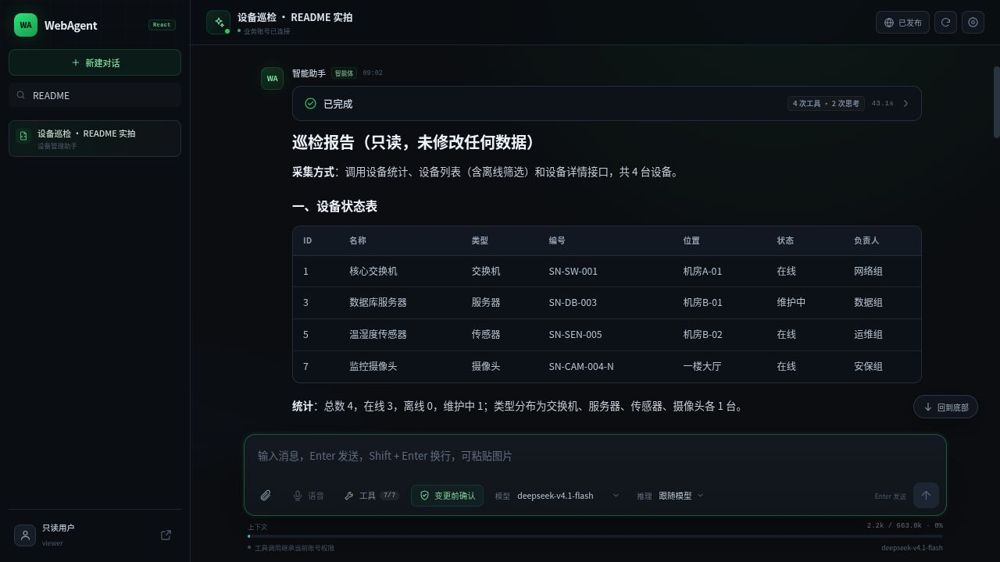
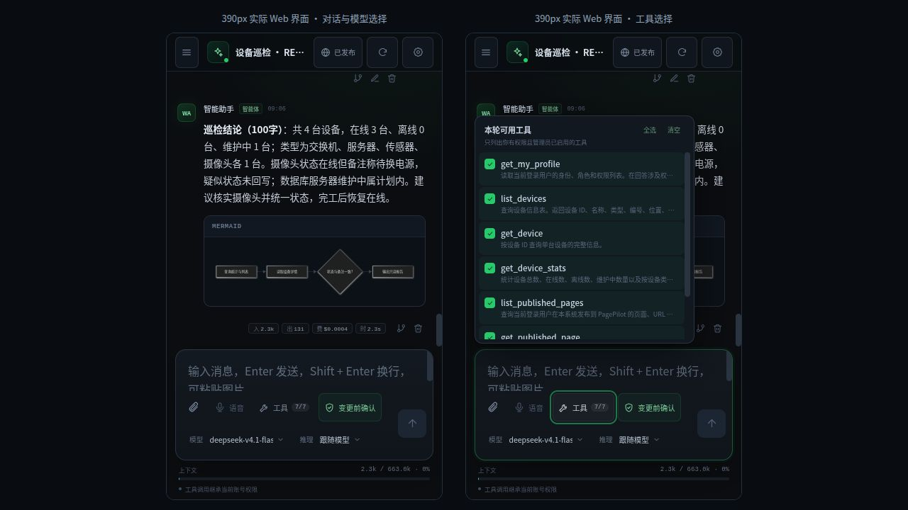
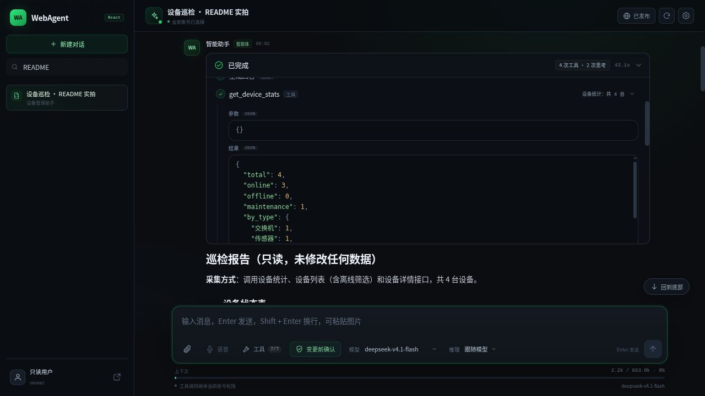
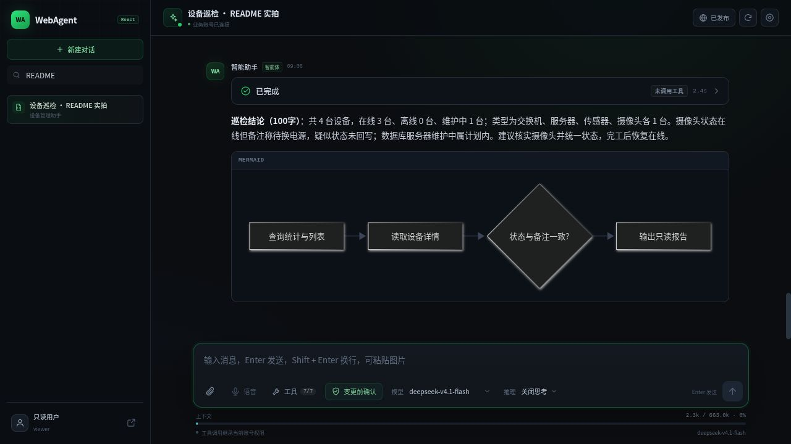
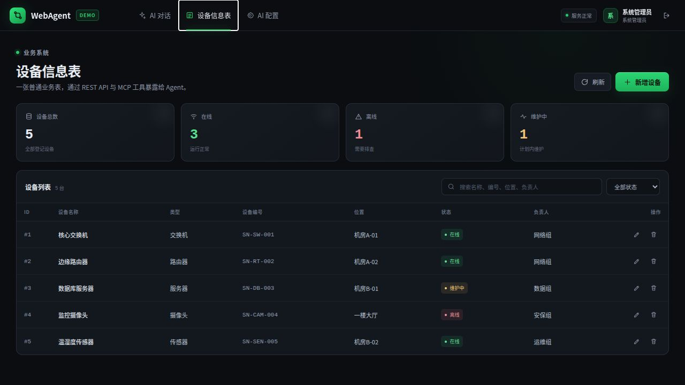
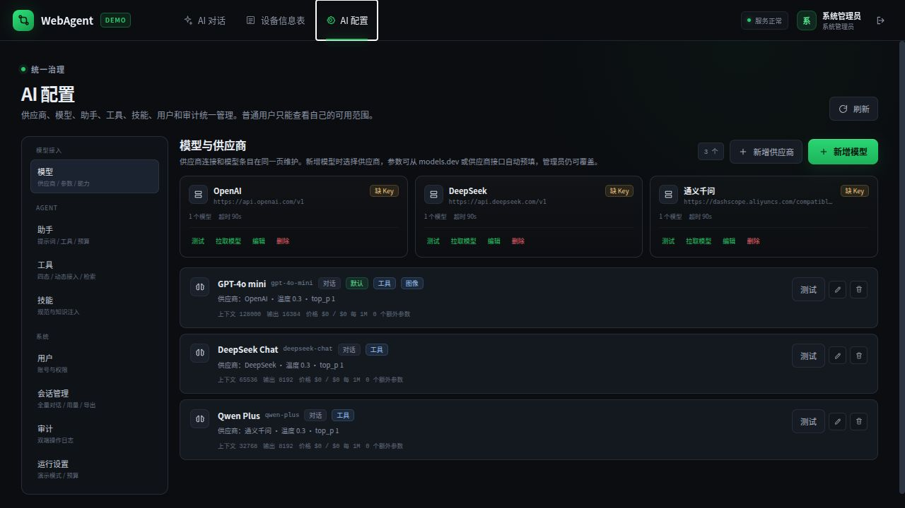
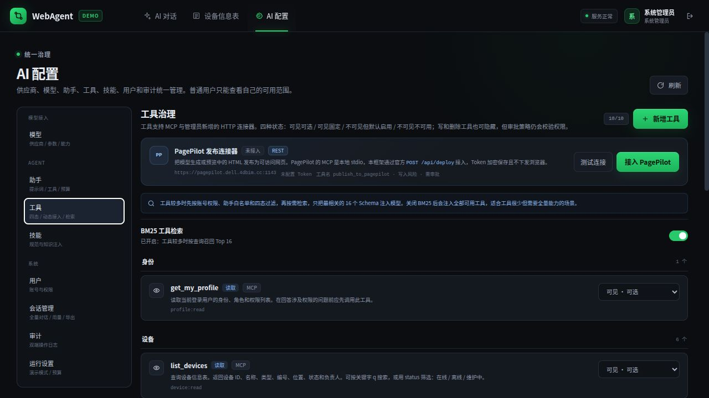
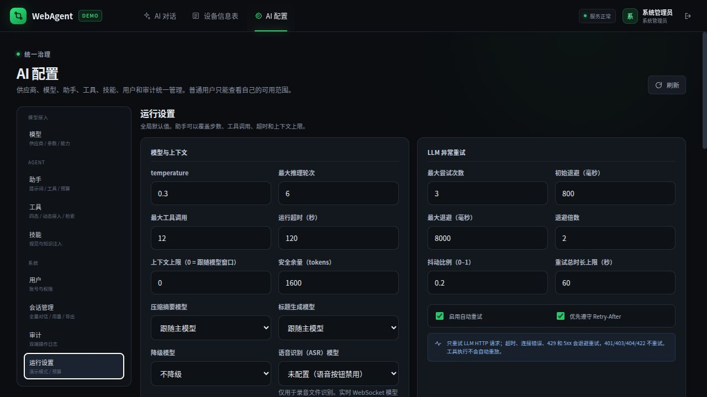
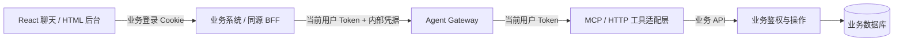

# WebAgent

**把 Agent 嵌入现有业务系统，让用户用对话完成自己有权执行的操作。**

WebAgent 是面向业务系统二次开发的 Agent 接入框架与可运行 Demo。它提供服务端 Agent 运行时、工具适配、模型与权限治理，以及可复用的 React 聊天组件；设备信息表只是用来验证完整链路的示例业务，不是框架的业务限制。

> 核心原则：Agent 不直接连接业务数据库，也不持有业务超级管理员凭据。它带着**当前登录用户的身份**调用业务 API；用户的权限，就是 Agent 的权限上限。

[界面预览](#界面预览) · [快速启动](#快速启动) · [功能概览](#功能概览) · [架构与权限](#架构与权限) · [业务接入与-sdk](#业务接入与-sdk) · [文档导航](#文档导航) · [当前边界](#当前边界)

## 界面预览

### 桌面对话

真实模型调用只读设备工具，生成 Markdown 巡检报告。执行过程默认只占一行，点击可展开；输入框提供工具、执行方式、模型和推理等级选择，上下文进度放在输入框下方。



### 移动端

相同组件在 390px 视口下展示对话、模型选择、用量与工具选择面板。这里是**响应式 Web / 小程序接入的交互参考**，不是已交付的微信原生小程序。



<details>
<summary>展开查看工具过程、Mermaid、设备表与管理员后台（6 张）</summary>

### 工具过程

过程条可展开执行时间线，工具可进一步查看参数与结果；完成后自动收起，不把每次调用一直铺在聊天正文中。



### Markdown 与 Mermaid

正文增量解析，支持表格、代码、公式、Mermaid 和受控 JSON 数据图表。Mermaid 在流式片段可解析时更新，不等待整轮回答结束。



### 示例业务系统

设备信息表提供查询、筛选、新增、修改、删除；按钮可见性与服务端授权都跟随业务账号权限。



### 模型管理

供应商连接与模型条目在同一页维护，支持拉取模型、同步元信息、能力参数和测试。截图中的预置条目尚未配置 Key，不表示已连接这些供应商。



### 工具治理

管理员维护四态工具、动态 HTTP 工具、PagePilot 连接器与 BM25 开关。工具来源会标识为 MCP、内置 Tool 或 HTTP 连接器，不把所有工具统称为 MCP。



### 运行设置

统一维护步数、工具次数、超时、辅助模型、上下文与重试；同页还提供会话保留、思考存储等隐私配置。



</details>

截图采自正式程序，不是原型图：聊天来自真实模型与只读工具，管理页来自无密钥的独立演示实例，两者数据量可能不同。截图日期、取景与更新说明见 [截图说明](docs/images/README.md)。

## 快速启动

### 方式一：Docker Compose（推荐）

准备 Docker Engine、Compose v2 和 Python 3；首次构建需要能访问镜像、npm、PyPI 与系统软件源。

```bash
git clone https://github.com/ZiDuNet/webagent.git
cd webagent
python3 scripts/init_env.py
COMPOSE_BAKE=false docker compose up -d --build --wait --wait-timeout 180
docker compose ps
```

| 入口 | 地址 |
| --- | --- |
| React 聊天（默认首页） | <http://127.0.0.1:8080/> |
| 设备表 / 完整配置后台 | <http://127.0.0.1:8080/admin/> |
| 服务健康检查 | <http://127.0.0.1:8080/api/health> |

管理员账号为 `admin`，**随机初始密码在本机 `.env` 的 `WEBAGENT_ADMIN_PASSWORD` 中查看**。初始化脚本以 `0600` 权限创建文件，已有文件不会覆盖；不要把 `.env`、展开后的 Compose 配置或密钥贴到工单、截图和 Git 中。

新实例默认开启明确标记的**演示模式**：不请求外部 LLM，通过本地规则调用真实业务工具，方便先验证权限与审批。它不是大模型效果展示。要使用真实模型，按下一节完成配置。

```bash
docker compose logs --tail 100 business agent mcp
docker compose stop
docker compose start --wait
docker compose down
```

`down` 保留数据卷；**不要随意执行 `down -v`，它会删除数据**。Compose 使用独立数据卷，不自动导入或覆盖仓库内的本地 `data/`。端口、HTTPS、备份恢复和构建排错见 [部署手册](docs/DEPLOYMENT.md)。

### 方式二：Python 本地运行

要求 Python 3.11+、Node.js 22.18+ 和 npm。容器使用 Python 3.13，原生开发也在 Python 3.14 验证过。

```bash
git clone https://github.com/ZiDuNet/webagent.git
cd webagent
python3 -m venv .venv
source .venv/bin/activate
pip install -r requirements.txt
(cd frontend && npm ci && npm run build)
python run_demo.py --open
```

上面的命令使用 Bash；`run_demo.py` 的进程启停实现面向 Linux/macOS，Windows 建议在 WSL2 或 Docker 中运行。

| 服务 | 默认地址 | 职责 |
| --- | --- | --- |
| 业务系统 | `127.0.0.1:8000` | 登录、设备 API、同源代理、页面 |
| Agent Gateway | `127.0.0.1:8010` | 推理、会话、工具治理、审批、用量 |
| MCP Server | `127.0.0.1:8020/mcp` | 示例业务 API 的工具适配 |

访问 <http://127.0.0.1:8000/> 默认进入同端口 React；完整后台在 <http://127.0.0.1:8000/admin/>。未构建 React 时，首页回到 HTML 后台。`Ctrl+C` 停止启动脚本管理的三个服务，端口已占用时拒绝重复启动。

本地日志在 `logs/`，数据库在 `data/`。`run_demo.py` **不自动加载 Compose 的 `.env`**，本地自定义环境变量需先导出。Markdown、公式与 Mermaid 资源随构建打包，不依赖 CDN。

可选依赖：HTML 保存图片需要 Chrome/Chromium；没有系统浏览器时运行 `python -m playwright install chromium`。部分语音协议需要 FFmpeg 转换录音格式。容器已包含 Chromium、FFmpeg 和中文字体。

### 配置真实模型

1. 用管理员登录，打开右上角配置入口，进入 **AI 配置 → 模型**。
2. 新增或编辑模型，在同一表单配置供应商、OpenAI-compatible Base URL 与 API Key。
3. 拉取供应商模型列表后选择模型 ID，或手工填写，再同步模型元信息；核对能力、上下文窗口、输出上限和价格。
4. 执行模型测试，启用该模型并按需设为默认；测试与真实聊天都会产生上游调用费用。
5. 在 **运行设置**中关闭演示模式并保存，再回到聊天页选择模型。

当前主对话实现 **OpenAI-compatible Chat Completions**，不表示已经兼容供应商的所有专有协议。模型发现和 models.dev 元数据只辅助填参，实际工具、多模态和推理能力仍以目标网关测试为准。真实模式缺少有效配置时返回错误，不伪造回答。

## 功能概览

| 模块 | 当前实现 |
| --- | --- |
| 聊天交互 | SSE 流式、单行过程与展开详情、结束自动收起、模型与推理等级选择、工具选择、每轮用量 |
| 内容展示 | 安全 Markdown、表格、可滚动代码框、KaTeX、Mermaid、柱状/折线/面积/饼环图 |
| 会话 | 用户隔离、重命名、分叉、删除、消息编辑/删除；管理员筛选、查看与导出 |
| 运行时 | 自研单 Agent loop、不同助手配置、最大步数/工具次数/时长、重试、可选降级模型 |
| 上下文与记忆 | 跟随模型的预算、自动/手动压缩、独立摘要模型、用户手动长期记忆、思考存储开关 |
| 工具与 Skill | 示例 MCP、动态 HTTP 工具、内置 Tool、四态治理、可关闭 BM25、知识型 Skill 渐进加载 |
| 权限与审计 | 继承登录用户身份、工具授权过滤、写/删审批、业务 API 最终 RBAC、业务与 Agent 双侧审计 |
| 模型管理 | 供应商与模型同页配置、模型列表发现、元数据同步、能力参数、模型类型相关测试 |
| HTML 与发布 | 隔离 HTML 预览、保存 PNG、PagePilot 新建/更新、本地发布归属和版本记录 |
| 多模态 | 图片输入；录音经已配置的文件 ASR 转为文字后发送，未配置或协议不支持时禁用 |

**前端现状**：`frontend/` 是 React + TypeScript 聊天及可复用组件，`web/` 是 HTML/JS 完整业务与配置后台；二者在同一实例共享后端、登录态与权限。不是整套管理后台都已迁移到 React。

**助手 ≠ 多 Agent**：助手是提示词、默认模型、工具白名单、Skill 和预算的一组配置。普通助手由模型决定是否及如何调用工具；单步报告助手按配置预采集只读数据，再生成报告。手动预览、发布等 UI 操作也不是“AI 自主工具调用”。

## 架构与权限



- **业务系统**持有业务数据，负责登录、角色、对象归属、字段约束和最终授权。
- **Agent 服务**管理模型、推理、工具过滤、会话和审批，不 import 设备业务代码、不连接业务库。
- **工具适配层**把业务 API 描述成工具，不使用业务超级管理员身份绕开业务校验。
- **浏览器**只访问业务系统同源入口，不持有 LLM API Key、内部服务密钥或 PagePilot 共享 Token。

### 演示账号与权限矩阵

| 账号 | 本地初始密码 | 查询 | 新增 | 修改 | 删除设备 | 用户管理 / AI 配置 |
| --- | --- | :---: | :---: | :---: | :---: | :---: |
| `admin` | `admin123`；Compose 为 `.env` 中的随机值 | ✓ | ✓ | ✓ | ✓ | ✓ |
| `user1` | `user1pass` | ✓ | — | — | — | — |
| `user2` | `user2pass` | ✓ | — | ✓ | — | — |
| `user3` | `user3pass` | ✓ | — | ✓ | ✓ | — |

密码与演示用户只在**首次创建业务库**时初始化；修改环境变量不会重设已有账号密码。正式部署应关闭演示用户种子并移除已有演示账号。

例如 `user2` 要修改设备时，完整链路是：

```text
用户消息 → BFF 校验登录 → Agent 再确认身份
  → 权限 / 助手 / 管理员开关 / 本轮勾选过滤工具
  → 模型发起 update_device → 展示审批卡
  → 用户批准 → 再校验当前权限与工具开关
  → 带同一用户 Token 调业务 API → 业务最终授权 → 执行并审计
```

「完全访问」仅在管理员允许时跳过操作确认，**不提升账号权限**。用户不能通过修改前端 `user_id`、加载 Skill 或切换模型获得删除权限；具体数据行和字段能否访问，仍需接入方业务 API 校验。

### 工具四态与检索

| 状态 | 用户看到工具 | 用户可切换 | 默认进入候选工具 |
| --- | :---: | :---: | :---: |
| 可见可选 | ✓ | ✓ | ✓，允许取消 |
| 可见固定 | ✓ | — | ✓ |
| 不可见默认启用 | — | — | ✓ |
| 不可见不可用 | — | — | — |

四态不替代账号授权与审批。BM25 只对通过授权的候选工具做相关性检索，通常召回 16 个 Schema；固定启用工具和运行时 Skill 工具可能额外加入，所以不是总工具数的绝对上限。关闭 BM25 后注入全部合规候选工具，工具很多时注意上下文占用。

## 业务接入与 SDK

不是“随便拿一个系统零改造即可接入”，而是把开发工作收敛到**身份、工具、同源代理和审计**四个契约。设备表可替换成工单、资产、订单或其他业务，不需要重写 Agent loop。

### 接入路径

| 现有条件 | 推荐方式 |
| --- | --- |
| 已有 REST API / 小程序后台接口 | 注册 HTTP Tool，继续调用已有 API，不必额外启动 MCP |
| 已有业务 service 函数 | 用 `serve_tools()` 或自己的路由包装函数，保留业务鉴权，再注册 Tool |
| 已有远程 MCP / 需要协议标准化 | 实现工具元数据与用户身份透传，通过 `WEBAGENT_MCP_URL` 接入 Streamable HTTP |
| 需要完全自定义基础能力 | 在代码中实现原生 Tool，接入统一权限、审批、审计与事件链路；不开放任意上传代码执行 |

### 注册一个已有 HTTP 接口

服务端 SDK 在 [`webagent/sdk.py`](webagent/sdk.py)，当前随仓库源码提供，不是已发布到 PyPI 的独立包。以下示例在**受信任服务端**注册一个接口；示例域名需替换为实际业务地址。

```python
import os

from webagent.sdk import AgentAdminClient, ToolSpec

client = AgentAdminClient(
    agent_url=os.environ.get("WEBAGENT_AGENT_URL", "http://127.0.0.1:8010"),
    internal_secret=os.environ["WEBAGENT_INTERNAL_SECRET"],
)

client.upsert_tool(
    token=os.environ["WEBAGENT_ADMIN_TOKEN"],
    spec=ToolSpec(
        name="list_orders",
        description="查询当前登录用户有权查看的订单",
        input_schema={
            "type": "object",
            "properties": {"status": {"type": "string"}},
        },
        permission="order:read",
        risk="read",
        method="GET",
        url_template="https://business.example.com/api/orders",
    ),
)
```

`WEBAGENT_ADMIN_TOKEN` 是示例脚本所需的**业务管理员会话 Token**，由接入方在服务端获取，不是模型 API Key，也不是框架自动生成的默认环境变量。它只用于注册工具；普通用户执行工具时，框架透传的是**该普通用户自己的 Token**。

### 最小落地顺序

1. 对接可信的当前用户接口，返回稳定用户 ID、角色和权限 action code；Demo 使用 `/api/me`。
2. 选择少量高频业务 API，声明工具名称、描述、JSON Schema、所需权限和风险等级。
3. 在业务系统挂载 `/api/agent/*` 同源代理：校验原有 Session/SSO，再注入用户 Token 与内部服务凭据。
4. 嵌入 React 组件或参考 HTML 实现，消费 SSE、展示审批与真实工具结果；不把服务端密钥交给前端。
5. 用只读、可修改、可删除三个账号验收正常操作、越权拒绝、审批后权限变更与重复提交。

已有 Cookie、JWT、OAuth 或企业 SSO 时，替换的是身份适配/BFF，不是要求业务系统改用 Demo 登录。当前存储使用稳定整数用户 ID；字符串 ID、多个业务系统共享实例或租户隔离需要先扩展身份命名空间，不能直接混用重号的用户 ID。

完整 SDK、FastAPI 回调、动态变量、MCP 元数据、鉴权融合、SSE 与验收清单见 [业务系统对接手册](docs/INTEGRATION.md)。组件导出位于 [`frontend/src/index.ts`](frontend/src/index.ts)，用法见 [React 接入说明](frontend/README.md)。

## 运行与扩展说明

### 上下文、思考和慢请求

- 上下文按所选模型窗口、输出预留与安全余量计算；全局上限为 `0` 时跟随模型。当前是 token 预算与摘要策略，不是固定“只携带最近 N 轮”。
- 历史估算超过预算时自动摘要，也提供手动压缩接口与 HTML 后台按钮；模型溢出时还有应急裁剪。React 对话入口当前未提供完整后台的所有操作按钮。
- 思考仅在上游返回时展示，不伪造推理文字。`store_reasoning` 默认关闭，本轮页面可展开查看，刷新不恢复；开启后才持久化保存。
- 管理员可查看会话逐次 LLM 调用、工具执行、重试、压缩和用量，区分模型等待、工具慢与上下文开销；前端动效不会缩短上游首 token 延迟。
- 关闭浏览器不会主动取消已启动的服务端任务；断线重放需通过运行 ID 与事件游标恢复。服务重启会中断未完成任务，当前没有持久化任务队列。

模型协议、参数默认值、压缩触发、语音适配、重试与数据保留见 [运行配置说明](docs/RUNTIME.md)。

### PagePilot 与 HTML

在 **AI 配置 → 工具 → PagePilot 发布连接器**配置服务地址、Token 并测试启用。当前通过 PagePilot 官方 REST 适配，而不是在 Agent 进程里启动本地 stdio MCP。

- 模型 HTML 使用产物卡片和隔离 iframe，不作为业务页面 DOM 直接执行；保存图片由后端渲染，关闭 JavaScript 并阻断外部请求。
- 用户可以新建、更新、预览页面，查看自己的发布 URL、内容和历史版本；共享 Token 仅保留在后端。
- 归属来自可信业务用户 ID，`session_id` 只记录来源。发布列表读取本地记录，**不从全局 Token 拉取其他用户的站点**。
- 每次发布/更新由用户决定标题、可选说明、密码与可见范围，密码可留空且不自动生成；Agent 调用前需获取用户选择。
- 发布部分成功时保留 URL 与警告，不把内容发布成功等同于密码、可见性设置全部成功。目标 PagePilot 版本仍需实际授权验收。

详细协议、SDK 和更新规则见 [PagePilot 接入](docs/INTEGRATION.md#35-pagepilot-发布连接器)。

### Skill、知识库与基础工具

Skill 是知识型渐进加载：先提供名称/描述，再按需调用 `load_skill` 读取 `SKILL.md` 正文，需要时读取登记的参考文件。**Skill 不执行脚本，也不授予业务权限**；可执行动作做成受控 Tool。

当前内置的是示例设备/身份工具、Skill 加载能力和本地发布记录查询等。天气、网络搜索、生图、Word、第三方知识库不是默认已开通服务，可按目标业务开发原生 Tool、HTTP 或 MCP 连接器；例如 RAGFlow / IMA 是否可接，取决于对方可用接口及授权，不承诺仅填 URL 即可使用。

## 开发与验证

前后端分开开发时，先启动本地三服务，再在另一个终端运行：

```bash
cd frontend
npm ci
npm run dev
```

开发页为 <http://127.0.0.1:5173/>，`/api` 代理到本地 `8000`。生产构建仍由业务系统同源提供，不必单独部署 Vite 服务。

```bash
python scripts/test_asr_protocol.py
python scripts/test_publications.py
python scripts/test_publications_api.py
python scripts/test_review_regressions.py
(cd frontend && npm run test:conversation && npm run build)
git diff --check
```

Python 回归使用临时数据库和 Mock 上游；Mock 验证协议与异常处理，**不等于供应商或第三方远端已验收**。`scripts/smoke_test.py` 会临时改变运行配置并操作测试会话，只在隔离实例运行，不要对正在使用的业务库执行。具体检查记录见 [审查与验收](docs/REVIEW.md)。

### 目录结构

```text
webagent/
  business/          示例业务系统：登录、RBAC、设备 API、同源 BFF
  agent/             运行时、模型协议、会话、工具、审批、审计与发布
  mcp_server/        示例 MCP：携带用户身份调用业务 API
  common/            安全与存储辅助
  sdk.py             服务端 SDK：ToolSpec、工具注册、FastAPI、PagePilot
frontend/            React + TypeScript + Vite，Radix Dialog 与可复用组件
web/                 HTML/JS 业务与配置后台
scripts/             初始化、健康检查、隔离回归与冒烟测试
docs/                架构、接入、运行、部署、验收与真实截图
run_demo.py          本地三服务启动入口
compose.yaml         单机容器部署
Dockerfile           React 构建 + Python 运行时镜像
```

## 文档导航

| 文档 | 内容 |
| --- | --- |
| [架构设计](docs/ARCHITECTURE.md) | 服务职责、权限传播、Agent loop、存储与演进方向 |
| [业务系统对接手册](docs/INTEGRATION.md) | 身份、MCP / HTTP / 直连 Tool、SDK、BFF、SSE、验收清单 |
| [运行配置说明](docs/RUNTIME.md) | 模型、推理、ASR、上下文压缩、重试、隐私与容量 |
| [部署手册](docs/DEPLOYMENT.md) | Compose、环境变量、独立数据卷、备份恢复与生产边界 |
| [React 接入说明](frontend/README.md) | 聊天组件、过程交互、发布记录、移动端与协议接入 |
| [审查与验收](docs/REVIEW.md) | 已执行检查、隔离测试方法与已知限制 |
| [截图说明](docs/images/README.md) | 正式界面截图来源、视口和更新规范 |

## 当前边界

本仓库是**单机、面向二次开发的框架 Demo**，不是开箱即用的多租户生产平台：

- **运行与存储**：会话等保存在服务端 SQLite；运行锁、后台任务和 SSE 重放缓存在单进程内。保持单 Agent 副本、单 worker；扩容前外置任务、锁与事件存储。审批记录持久化不代表任务能跨重启恢复。
- **MCP 接入**：当前连接配置的远程 Streamable HTTP MCP；没有后台新增/管理任意 stdio、SSE、HTTP 三种 MCP 服务器的完整控制面，也没有可安装连接器市场。
- **记忆与知识库**：长期记忆只做手动维护；自动抽取、租户文档上传、内置 RAG、PDF 解析和任意脚本沙箱未实现，第三方知识库按受控工具扩展。
- **多模态**：支持图片与文件 ASR 转文字，不支持实时 WebSocket 语音会话。模型类型识别或供应商 `/models` 返回条目不等于实际接口可用。
- **身份与治理**：未内置企业 SSO、多租户组织隔离、精细账单对账或完整合规归档。默认会话保留 30 天，启动时清理；发布内容需独立规划保留与容量。
- **生产安全**：仅业务 BFF 对外，内部服务放私网；部署 HTTPS、独立且稳定的加密根密钥、业务对象级鉴权、限流及工具目标限制，关闭演示模式并移除演示账号。API Key 加密不能替代主机、数据库和备份权限管理。

交互设计参考了 [Agent2API](https://github.com/aimod-cc/Agent2API) 和 [Octop](https://github.com/TencentCloud/Octop) 等开源项目，不依赖其运行时。若后续引入第三方源码，请分别核实许可；本仓库当前未附 `LICENSE`，不要自行推定为 MIT / Apache 等授权。
