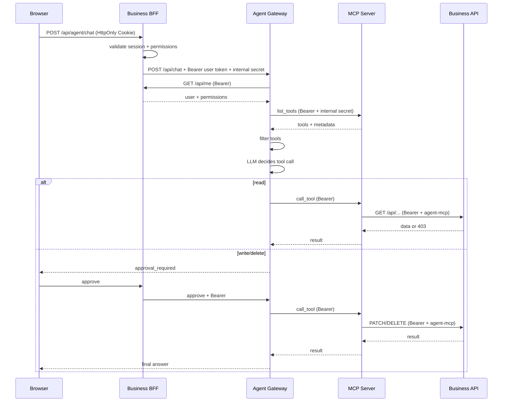

# WebAgent 架构与通用化设计

## 1. 目标

WebAgent 要解决的问题不是“做一个聊天框”，而是：

> 在不改造业务系统核心代码、不复制用户权限体系、不把数据库交给模型的前提下，让 Agent 能在现有后台里安全地调用业务能力。

因此系统被拆成三层，并且每层只有一个清晰职责：

| 层 | 职责 | 不应该做什么 |
|---|---|---|
| 业务系统 | 身份、RBAC、业务规则、数据、最终审计 | 不包含 Agent 推理逻辑 |
| 工具适配层 | 通过 MCP 或直连 HTTP Tool 暴露业务能力，透传用户身份 | 不直连业务数据库，不持有超级 Token |
| Agent Gateway | 模型调用、工具过滤、审批、治理 | 不 import 业务代码，不信任前端身份 |

---

## 2. 组件

### 2.1 业务系统 `:8000`

Demo 提供：

- `POST /api/login`
- `POST /api/logout`
- `GET /api/me`
- `GET/POST/PATCH/DELETE /api/devices`
- `GET /api/devices/stats`
- `GET /api/users`
- `DELETE /api/users/{id}`
- `GET /api/audit`

关键设计：

- 浏览器使用 HttpOnly Cookie。
- 会话 Token 在数据库中只存 SHA-256 摘要。
- 每个设备接口单独检查 action code。
- `/api/agent/*` 是同源代理，浏览器不直连 Agent。
- MCP 调用业务 API 时带 `X-WebAgent-Source: agent-mcp`，审计能区分来源。

### 2.2 工具适配层 `:8020`

MCP 服务提供以下基础工具：

| 工具 | 权限 | 风险 | 说明 |
|---|---|---|---|
| `get_my_profile` | `profile:read` | read | 当前用户身份 |
| `list_devices` | `device:read` | read | 设备列表 |
| `get_device` | `device:read` | read | 设备详情 |
| `get_device_stats` | `device:read` | read | 设备统计 |
| `create_device` | `device:create` | write | 新增设备 |
| `update_device` | `device:update` | write | 修改设备 |
| `delete_device` | `device:delete` | delete | 删除设备 |
| `list_users` | `user:manage` | read | 用户列表 |

每个工具的描述尾部都有元数据：

```text
[META] permission=device:read; risk=read; category=设备 [/META]
```

Agent 解析后会把元数据从模型可见描述中移除，只用于自己的权限过滤。

MCP 服务使用 `X-Internal-Token` 做服务间鉴权。该密钥只解决“谁能访问 MCP 进程”，不解决“用户能做什么”。用户权限始终由 Bearer Token 决定。

除静态 MCP 工具外，管理员还可以在后台新增**动态 HTTP 工具**。动态工具复用同一套权限、风险等级、审批和审计链路，但不需要改 Agent 代码：

- 配置名称、描述、权限 action code 和 `read/write/delete` 风险等级。
- 配置 HTTP 方法、URL 模板和输入 JSON Schema。
- 路径参数从工具参数中替换；GET/DELETE 使用 query，POST/PUT/PATCH 使用 JSON body。
- 运行时始终注入当前用户的 `Authorization: Bearer <token>`，业务 API 仍做最终授权。
- 禁止覆盖 `Authorization`、`Host`、`Content-Length` 等敏感 Header。

工具最终可用集合按以下顺序计算：

```text
账号权限
  ∩ 助手工具白名单
  ∩ 管理员四态配置
  ∩ 用户本轮勾选
  -> BM25 检索
  -> 最多注入 16 个工具 Schema
```

四种治理状态为：可见可选、可见固定、不可见默认启用、不可见不可用，对所有工具生效，写/删工具也可以隐藏。隐藏只改变用户侧可见性和勾选能力，审批卡与业务 API 的 RBAC 仍然生效。BM25 只在已经通过权限和四态过滤的工具中做名称、描述、分类和参数名检索，目的是控制大量工具带来的上下文成本，不是权限判断。BM25 可以关闭；关闭后全部可用工具直接进入上下文。

### 2.3 Agent Gateway `:8010`

核心步骤：

```text
verify internal token
  -> verify user bearer via business /api/me
  -> choose assistant + model (admin-configured, enabled)
  -> load enabled skills and user memory
  -> list MCP + dynamic HTTP tools
  -> filter by permission ∩ assistant whitelist ∩ four-state policy ∩ user selection
  -> BM25 rank and inject at most 16 tool schemas
  -> build/compact context and fit model budget
  -> run Agent loop
  -> read tools execute immediately
  -> write/delete tools create a persisted approval in confirm mode
  -> full_access skips confirmation but keeps the same user token and RBAC
  -> audit
  -> emit SSE events for thinking/tool/retry/completion
```

Agent 服务同时负责管理员配置：

- 模型接入（当前仅 OpenAI-compatible）：供应商 Base URL、加密 API Key、额外 Header、超时、模型发现和测试。
- 模型参数：能力、上下文窗口、输出上限、思考能力与强度、多模态、价格和额外请求参数。
- 默认模型、降级模型、标题生成模型、上下文压缩模型、ASR 模型；标题/压缩模型留空时继承主模型，ASR 未配置则关闭语音输入。
- 助手配置（提示词、默认模型、工具白名单、记忆开关）
- 工具四态、动态 HTTP 工具与 BM25 检索
- PagePilot 发布连接器（REST，Token 加密）、按业务用户隔离的本地页面/版本，以及服务端 HTML 截图
- Skill 与参考文件
- 上下文、压缩、运行上限、全局重试和额度设置
- 对话体验：空态标题/副标题/问题、默认执行模式、完全访问开关、默认推理等级
- 全量会话管理、用量统计和导出
- Agent 审计与逐次 LLM 调用记录

供应商 API Key 使用 `WEBAGENT_SECRET_KEY` 派生 Fernet 密钥加密落库；管理接口只返回掩码，不下发明文 Key。旧明文 Key 会在启动时迁移。

### 2.4 浏览器 UI

- 业务系统同源静态页面。
- 暗色管理台风格，三个主菜单。
- 对话界面支持模型切换、推理等级、助手切换、工具选择、执行模式和审批卡。
- SSE 实时显示供应商返回的思考、工具执行、重试和降级。思考、工具和回答合并为一条过程状态条：执行中显示当前动作，结束后变为“已完成 · N 个步骤”；点击展开步骤，再点工具展开参数和结果。思考默认仅实时展示，是否持久化由管理员的 `store_reasoning` 决定。流式文本只更新当前消息节点，避免整页重绘闪烁。
- Markdown 先转义再生成受控 HTML，支持表格、引用和 `chart` 结构化图表；HTML 代码块只显示产物卡片，在无同源权限的 iframe 中预览。
- 上下文进度条位于输入框下方；右侧面板显示工具、技能、运行预算和会话累计详情。
- 支持图片附件、手动压缩、长期记忆管理和设备统计结果数据卡/条形图。
- 管理员配置 ASR 模型后，输入框旁语音按钮可用；识别完成后直接发送；未配置时按钮禁用。
- 管理页支持模型、助手、工具、Skill、会话、用户、审计、运行设置和用量统计。
- 原生 HTML/JS 管理台与独立 React 接入界面并行；React 提供可复用聊天组件和真实登录、对话、发布/记录页面，不代表原生管理台已全部迁移。移动样式模拟小程序端，实际微信原生组件接入仍需按同一接口契约实现。

### 2.5 代码目录

```text
webagent/
  business/             # 模拟业务系统：登录、RBAC、设备 CRUD、同源代理
  mcp_server/           # MCP 工具适配层，只调用业务 API
  agent/
    app.py              # Agent HTTP API、SSE、管理员接口
    runtime.py          # 单 Agent loop、工具执行、审批恢复、降级与审计
    context.py          # 上下文构建、预算、自动/手动/溢出压缩
    llm.py              # OpenAI-compatible 请求、重试、usage 归一化
    providers.py        # 模型发现、models.dev 元数据与能力预填
    sessions.py         # 会话、消息、标题与用量持久化
    db.py               # Agent SQLite schema 与查询
    crypto.py           # API Key 加密与迁移
    dynamic_tools.py    # 管理员配置的 HTTP 工具
    tool_search.py      # 工具目录的 BM25 检索
    mcp_client.py       # MCP 工具发现与调用
    pagepilot.py        # PagePilot REST 发布与更新
    publications.py     # 当前业务用户的本地发布记录及内容版本
  common/               # 内部鉴权与服务间请求
  config.py             # 端口、数据目录、密钥与会话配置
docs/
  ARCHITECTURE.md       # 本文
  INTEGRATION.md        # 业务系统接入手册与验收清单
```

### 2.6 PagePilot 共享服务与本地归属

PagePilot 的服务 Token 由整个业务系统共享，只用于后端调用远端发布接口。它不能用来区分本系统用户，因此 WebAgent 使用独立的本地归属索引：

| 数据 | 来源与作用 |
|---|---|
| `publications.user_id` | Agent 用当前业务 Token 向身份接口确认的用户，作为所有权边界 |
| `publications.session_id` | 可选来源会话，用于筛选与追溯，不参与授权 |
| `remote_base_url` + `code` | 锁定发布目标；更换连接器地址后不能误更新原服务页面 |
| `publication_versions` | 每次发布尝试的 HTML、标题、说明、大小、URL、远端版本与状态快照 |

发布读取链路为「业务 BFF 校验登录 → Agent 确认业务用户 → 本地按 `user_id` 查询」，不通过 PagePilot 全量站点接口或 MCP `list_sites` 拉取共享 Token 下的全部页面。浏览器、模型参数和任意 `session_id` 都不能指定数据所有者；读其他用户的记录返回 404。未知旧 `code` 不允许更新，也不会自动导入远端历史或从旧聊天文本猜测归属。

远端内容新建和更新统一使用 `POST /api/deploy`。更新时仅允许本地已归属的目标，后端传 `customCode`、`enableCustomCode=true`、`createVersion=true` 追加版本，返回 code 不一致时停止后续设置并提示核对远端状态。不能把普通 `code` 字段直接 POST 成新建，也不对结果未知的内容写入自动换路由重试。新建时非空的用户密码通过 `accessPassword` 随内容提交。

密码和可见范围保留 `PATCH /api/deploys/{code}/access`、`PATCH /api/deploys/{code}/visibility`，仅当响应为 404/405 时，分别回退到官方 POST 兼容别名 `/api/deploys/{code}/access/set`、`/api/deploys/{code}/visibility`。超时、5xx 或其他错误均不触发该回退。`POST /api/deploys/{code}/access` 是访客验证密码接口，不能用于设置密码。

每次发布/更新先创建本地版本，再执行远端内容写入、密码和可见范围设置。内容快照不覆盖，发布状态和响应可随本次尝试完成而更新；后续修改产生新版本，旧 HTML 保留。成功状态为 `published`；内容已发布但访问设置失败为 `partial`，保留 URL 和警告；内容请求失败为 `failed`。部分失败不能视为全部成功，也不应自动重新创建远端页面。进程中断的未完成记录在重启后标为失败并提示核对远端，避免把未知结果误报为成功。

协议设计来源是 PagePilot [公开 OpenAPI](https://pagepilot.chaoxi.live/openapi.json)、[生产网页脚本](https://pagepilot.chaoxi.live/app/assets/index.js)和[官方 Skill/CLI 包](https://pagepilot.chaoxi.live/skill/pagep.zip)。本轮使用只读证据与隔离 Mock 回归，不代表远端写入或兼容路由已在目标部署验收。

用户在每次发布或更新时选择密码和 `visibility`；密码可以为空，系统不自动生成。空串明确表示清除密码；兼容 HTTP API 的省略字段表示更新时保留原密码，UI/SDK 应显式传本轮选择。`unlisted` 仅影响是否公开列出，不是访问控制。数据库只保存 `password_set` 标记，不保存密码明文。

发布记录与会话有独立生命周期，`session_id` 没有级联删除关系。删除会话、清空消息或默认 30 天会话清理不会删除页面和历史 HTML；发布内容因此可能成为主要存储量。部署需分别制定本地数据库/版本备份、恢复演练、容量监控和按业务要求清理的策略，不能把会话保留期当作发布保留期。

---

## 3. 权限传播时序



重要的不是“Agent 知道用户是谁”，而是“Agent 没有能力使用另一个身份调用业务 API”。

---

## 4. 工具注册约定

### 4.1 命名

推荐 `资源_动作`：

```text
list_devices
get_device
create_device
update_device
delete_device
export_orders
refund_order
```

避免把所有能力塞进一个 `execute_sql` 或 `call_api` 万能工具。

### 4.2 参数

- 只暴露业务需要的字段。
- 明确必填/可选。
- 对枚举值在业务 API 再次校验。
- 不接受“任意 URL”“任意 SQL”“任意脚本”。

### 4.3 风险等级

| 风险 | 审批 | UI |
|---|---|---|
| read | 否 | 蓝色读取徽标 |
| write | 默认是 | 黄色写入徽标 |
| delete | 默认是 | 红色危险徽标 + 二次确认 |

如果业务动作是“导出全部客户”“重置密码”“下线服务器”，即使技术上不是 DELETE，也应按 delete 级风险处理。

审批策略由用户本轮选择的 `approval_mode` 决定：

- `confirm`：写/删工具生成审批卡，批准后执行。
- `full_access`：写/删工具直接执行，但账号权限、助手白名单、工具四态、用户勾选和业务 API RBAC 完全不变。

管理员可以在运行设置中关闭 `full_access`，也可以设置默认值。该模式只跳过确认，不扩大权限，并写入 Agent 审计。

### 4.4 错误

工具错误要保留业务语义：

```json
{
  "code": "PERMISSION_DENIED",
  "message": "当前账号缺少 device:delete 权限",
  "status": 403
}
```

Agent 应把错误原样告诉用户，而不是重试到成功或绕过权限。

---

## 5. Agent loop

### 5.1 演示模式

没有 API Key 或打开演示模式时：

- 使用确定性意图识别。
- 仍然走真实 MCP 工具链。
- 仍然执行权限过滤和审批。
- 仍然写审计。

这样 Demo 在没有外部模型的情况下也能证明“权限和工具链”是正确的。

### 5.2 真实模型

真实模型使用 OpenAI-compatible Chat Completions：

1. system prompt：身份、权限、技能、边界。
2. 模型返回 `tool_calls`。
3. read 工具立即执行，把结果作为 `role=tool` 消息回填。
4. write/delete 工具在 `confirm` 模式下暂停，生成持久化审批记录。
5. 用户批准后执行；`full_access` 模式跳过审批，但仍然使用同一个用户 Token。
6. 达到最大轮次或模型返回文本时结束。

审批记录保存在 SQLite 的 `pending_approvals` 表，内容包括：

- 用户 ID、用户名和会话 ID
- 模型
- 消息历史
- 剩余工具调用
- 已执行工具结果
- 配置和技能快照
- 过期时间与处理状态

审批被点击时使用 `pending -> processing` 的原子更新，因此重复点击不会重复执行；服务重启后仍可恢复。记录中**不保存明文登录 Token**。恢复审批时会重新调用 `/api/me` 确认身份，重新构建工具目录，并重新检查账号权限、助手白名单和工具四态。如果管理员已经禁用工具、权限已变化或会话已删除，审批会安全失败。

前端把一次运行合并成一行过程状态，默认不占空间；第一次展开看步骤摘要，第二次点某个工具才看参数和原始结果。Markdown 图表来自模型输出的受控 JSON（`type/title/unit/data`），不执行模型生成的 JavaScript。

---

### 5.3 SSE 运行事件

`POST /api/chat/stream` 返回 `text/event-stream`，响应头带 `X-Run-Id`。事件 ID 单调递增，客户端断线后可以用 `GET /api/chat/stream/{run_id}` 加 `Last-Event-ID` 恢复。服务端会校验运行记录属于当前用户，重放缺失事件并在 `run.completed` 后关闭连接。

主要事件：

| 事件 | 含义 |
|---|---|
| `run.started` | 模型、供应商、演示模式和本轮工具已确定 |
| `context` | 上下文预算、是否压缩 |
| `thinking.delta` | 供应商思考增量；实时展示，持久化由 `store_reasoning` 控制 |
| `tool.started` / `tool.finished` | 工具开始和结果摘要 |
| `tool.approval_required` | 写/删操作等待审批 |
| `retry` / `model.fallback` | LLM 重试和降级模型切换 |
| `usage` / `session.title` | 本轮用量和会话标题更新 |
| `run.completed` / `run.failed` | 本次运行最终状态 |

### 5.4 上下文构建与压缩

每次对话前由 `context.prepare_context` 统一构建模型上下文：

```text
session 历史（summary_until_id 之后的消息）
  + 已有摘要
  + system prompt
  + 当前工具/助手/权限说明
```

预算是估算值，不等于供应商的实际计费 token：

```text
context_window = 模型配置的 context_window
                 缺失时用全局 context_max_tokens
                 再缺失时回退 32768
max_context = context_window
              若全局 context_max_tokens > 0，再取 min
budget = max_context - 预留输出 - context_reserve_tokens
```

`context_max_tokens=0` 表示不额外封顶，优先尊重模型自己的原生窗口；`max_output_tokens` 会被限制在窗口的一半以内。最终预算至少保留一个很小的可用下限。

token 估算按 CJK 字符、英文单词和剩余字符做近似，用于判断“是否接近预算”，最终仍以供应商返回的 usage 为准。

压缩分三类：

1. **自动压缩**：构建上下文时超过预算，按 user 消息边界保留最近对话，较早消息生成摘要。
2. **溢出压缩**：供应商返回 context overflow 错误后，强制本地裁剪一次并重试。
3. **手动压缩**：用户点击按钮，直接调用 `POST /api/sessions/{id}/compact`。

摘要模型优先使用后台单独配置的 `compaction_model_id`；未配置时继承当前主模型。摘要模型失败时回退本地摘要，不阻塞主对话。所有压缩写入 `compaction_events`，包括触发方式、前后 token、摘要模型、耗时和错误。

压缩摘要只用于当前会话上下文，不自动写入长期记忆。长期记忆是用户手动维护的独立数据。

### 5.5 LLM 重试

框架关闭 SDK 自带重试，统一由 `chat_completion` 控制：

```text
attempt 1 -> 失败 -> 指数退避 + jitter -> attempt 2 -> ... -> 上限
```

- 可重试：超时、连接错误、`408/409/425/429/500/502/503/504`。
- 不重试：`401/403/404/422` 等明确客户端错误。
- `429` 优先遵守 `Retry-After`。
- 受 `retry_max_attempts`、`retry_max_elapsed_seconds`、最大退避共同约束。
- 每次尝试写入 `llm_calls`，失败尝试也保留。

重试配置是全局的，避免每个供应商重复维护一套策略。

### 5.6 用量与额度

模型返回的 usage 会归一化为输入/输出/总 token，并按模型单价估算费用。一次 Agent 运行可能包含多步模型调用，运行结束后合并 usage。

累计维度：

- 单次响应：本轮 usage、尝试次数、重试次数、耗时。
- 会话：累计 token、费用、工具调用、工具失败、审批拒绝、重试、压缩、错误。
- 用户：按天 token 和费用。
- 平台：按天、用户、模型的全局汇总。

`user_daily_token_limit` 是轻量额度闸门，`0` 表示不限制。它不是精确的账单系统，生产仍需独立的计量和对账。

### 5.7 语音和推理协议适配

普通对话使用 OpenAI-compatible Chat Completions，但「语音模型」不能统一按 `/v1/audio/transcriptions` 调用。`providers.transcription_config` 消费模型 `extra_params._asr`，决定上传与解析协议：

| 协议 | 适配 |
|---|---|
| `transcriptions` | multipart 文件上传，读取顶层 `text` |
| `chat_audio` | `messages[].content[].input_audio`，读取 Chat Completions 结果；标准为 Base64+格式，Qwen 默认 data URI |
| `dashscope` | 原生多模态端点；兼容 Qwen3-ASR 与 Qwen-Audio-3.x 的不同音频结构及输出 |
| 自动识别的 `realtime` | WebSocket 专用；当前录音文件上传入口明确拒绝 |

`_asr.endpoint` 可覆盖同源路径，不能把供应商 Key 转发到其他域名；跨域服务应建立独立供应商。Chat Audio/原生适配在需要时使用 FFmpeg 将浏览器 WebM/Opus、OGG、MP4 转为单声道 16 kHz WAV。转换失败、缺少 FFmpeg、超时、网关拒绝和无文本结果有不同错误；静音连接测试可接受合法空转写，但不能把缺失结果字段的 JSON 当成功。

模型列表只证明供应商声明了 ID，不证明对应路由已开放。本轮真实静音测试中，配置的 `qwen-audio-3.1-realtime-plus` 文件转写为 404；同网关 `qwen-audio-3.0-asr-flash` 的原生请求被拒绝为 `model ... is not allowed on this route`，兼容 Chat Audio 也为 400。当前不能宣称这套真实语音配置已可用；隔离 Mock 回归证明适配构建和解析符合协议，供应商开通情况必须独立验证。

推理控制通过 `providers.reasoning_config` 归一化：DeepSeek 混合模型用 `thinking.type=disabled/enabled`，Qwen 混合模型用 `enable_thinking=false/true`，标准模型在明确支持时用 `reasoning_effort=none`。用户的显式选择在合并默认额外参数后应用，防止模型默认开启覆盖用户关闭。固定推理模型不暴露虚假关闭选项，不支持的选择返回能力错误。`_reasoning`、`_asr` 等框架元数据不会发送给模型；供应商非标准参数通过 SDK 的 `extra_body` 发送。

对当前 DeepSeek 模型关闭推理的真实请求收到 `Hi` 且未返回思考内容，说明关闭参数可用；该次约 17 秒的上游延迟也说明推理开关不能替代首字/网络耗时观测。

---

## 6. 会话与管理员治理

### 6.1 会话归属

会话、消息、附件、审批、工具调用、压缩事件和 LLM 调用都按 `session_id` 关联。普通用户只能通过自己的身份读写自己的会话。

管理员默认拥有 `session:read_all` 权限，也可以授予其他角色。该权限只允许查看和导出，不允许“以该用户身份继续对话”。

### 6.2 管理员可见数据

`GET /api/admin/sessions` 支持：

- 用户名、助手、模型、状态筛选。
- 关键字搜索。
- 时间范围。
- 分页。

`GET /api/admin/sessions/{id}` 返回：

- 会话元数据与累计统计。
- 消息正文与附件。
- 工具调用参数、结果和状态。
- 审批记录。
- 压缩事件。
- 逐次 LLM 调用和失败原因。

导出支持 JSON、Markdown、CSV。查看和导出都写 Agent 审计。

### 6.3 隐私与保留

- `admin_session_content=1`：管理员可看正文、工具参数和结果。
- `admin_session_content=0`：只返回元数据和统计，正文/参数/结果替换为隐藏标记。
- `store_reasoning=0`：默认不保存供应商思考原文；本次实时页面仍可展开查看。设为 `1` 才持久化后续原文，不能恢复此前未保存的内容。
- 思考原文只写入消息独立的 `reasoning` 字段，运行元数据不重复保存；启动迁移会移除旧版 `metadata.run.reasoning` 中的重复原文。实时前端以内存保留本次思考，刷新页面不会恢复未持久化的内容。
- 上下文占用使用最后一次模型输入的 token 数，不用多步骤累计输入用量冒充当前上下文；输入预算为模型窗口与管理员/助手上限的较小值，再扣输出预留和安全余量，切换模型立即重算。
- `session_retention_days` 默认 30 天；`0` 表示不自动清理。
- 大于 0：Agent 启动时物理删除超过保留期的会话及其消息、压缩事件和 LLM 调用。生产环境建议扩展为「归档 → 宽限期 → 物理删除」三段式；当前 Demo 尚未实现归档字段，落地时需要补 `archived_at` 与宽限期清理任务。
- `publications` 和 `publication_versions` 不属于会话自动清理范围，发布记录/版本需单独备份与规划保留策略。

### 6.4 权限边界

管理员会话查看权不等于业务数据权限：

- 管理员不能借此调用业务工具。
- 会话中保存的是当时的工具结果，不是实时业务数据。
- 需要实时数据时，仍要使用自己的业务身份走正常工具链。

---

## 7. 通用 Connector 的抽象

要把这套东西变成产品，建议抽象成 Connector SDK：

```python
class Connector:
    name: str
    version: str

    async def describe(self, user_context) -> list[ToolDefinition]: ...
    async def call(self, tool_name, arguments, user_context) -> ToolResult: ...
```

每个 `ToolDefinition` 至少包含：

```json
{
  "name": "update_device",
  "description": "修改设备",
  "input_schema": {},
  "permission": "device:update",
  "risk": "write",
  "idempotency": "optional",
  "tenant_scope": "current"
}
```

一个业务系统的接入产物应该是一个 Connector 包，而不是修改 Agent 核心：

```text
connectors/
  crm/
    connector.py
    tools.json
    permissions.json
    README.md
  erp/
  itsm/
```

Connector 可以是：

- REST → MCP
- GraphQL → MCP
- gRPC → MCP
- 内部 service → MCP
- 老系统 Adapter Service → MCP

无论哪种，都遵守同一原则：**最终授权由业务系统做，Adapter 不持有超级权限**。

---

## 8. 多租户与多用户

Demo 已经做到：

- 每个请求重新确认用户。
- 工具执行携带用户 Token。
- 审批绑定用户。
- 工具选择按用户存 localStorage。
- Agent 不保存跨用户记忆。

生产还需要：

- `tenant_id` 进入 Token claim 和每次工具调用。
- 审批 key 包含 tenant + user + session。
- 缓存 key、对话 key、记忆 key 全部带租户。
- MCP 工具层校验 token audience，防止跨租户重放。
- 审计按租户隔离存储。
- 管理员权限和数据域解耦，避免“平台管理员”自动等于“所有业务数据管理员”。

当前明确暂缓、但保留契约的方向：

- 租户自助上传和检索知识库：需要文档解析、切片、向量/全文索引、租户隔离和引用回溯，不能把不同租户的资料混在同一个检索域。
- `soul.md` / `AGENTS.md` 一类多文件人格：当前只做数据库中的助手系统提示词和 `SKILL.md` 渐进式知识加载；若后续需要文件化人格，必须先定义加载优先级、冲突规则和审计。
- 文档/PDF 解析与生成：需要沙箱、文件生命周期和内容安全策略，当前不做；未来应作为独立工具或 MCP 服务接入。

---

## 9. 部署与安全

推荐网络拓扑：

```text
Internet
  -> WAF / LB
  -> Business BFF (public)
  -> Agent Gateway (private)
  -> MCP Server (private)
  -> Business API (private)
```

最低安全要求：

- 浏览器不直连 Agent / MCP。
- Agent 和 MCP 只监听私网。
- 内部服务密钥使用 Secret Manager 注入，不写在镜像里。
- API Key 只存服务端，加密保存，日志脱敏。
- 用户 Token 短 TTL、可撤销、绑定 audience。
- 写操作默认审批；完全访问只跳过确认，仍要审计并经过业务 RBAC。
- 工具参数做服务端 schema 校验。
- 对模型输出做提示注入防护，不把业务文档里的指令当系统指令。
- 限制单用户并发、模型配额和工具调用频率。
- 审批接口防 CSRF、防重放、防跨用户。
- 对话和审计数据设置保留期与脱敏策略。

---

## 10. 产品化路线

| 阶段 | 目标 |
|---|---|
| P0（本 Demo，已完成） | 权限继承、MCP 与动态 HTTP 工具、四态治理、SSE、审批持久化、上下文压缩、重试、会话与用量治理 |
| P1 | Connector SDK、OIDC/SSO、精确用量计费、多副本运行记录共享、审批 TTL 与运维告警 |
| P2 | 多租户隔离、租户知识库、模型路由、精细配额、可观测性与内容安全 |
| P3 | Connector 市场、行业模板、评测集、提示词版本管理 |

最终形态不是“一个万能 Agent”，而是：

> 一个安全的 Agent 运行时 + 一套标准业务连接器 + 一个管理员治理台。

这样拿到任何有 API 的业务系统，开发工作主要是写 Connector 和权限映射，而不是重写 Agent。

具体身份契约、动态工具配置、SSE 事件、审批恢复和接入验收步骤见 [INTEGRATION.md](INTEGRATION.md)。
