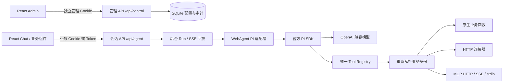

# 架构与职责

## 1. 三端分离

三个部署单元：

- `server/`：Fastify 后端，PI 运行时在后端，不在 Chat 浏览器内。
- `admin/`：React + Ant Design，管理账号独立，不读取业务登录态作为管理员凭证。
- `chat/`：React 对话界面，继承业务用户身份。响应式移动布局是小程序交互参考，不是可直接发布的微信小程序包。

`sdk/` 为可复用客户端，不是第四个部署服务。两个前端分别通过同源代理访问各自 API。Node 静态托管仅是本地便捷方式，Compose 默认用两个独立 Nginx 容器。

## 2. PI 与框架的分工

| PI 官方核心 | WebAgent 适配层 |
| --- | --- |
| 模型循环、模型流式解析 | 供应商配置、加密 Key、模型用途绑定 |
| 工具调用协议、参数校验 | 原生 / HTTP / MCP 统一工具、业务授权与审批 |
| SessionManager 会话树条目 | SQLite 归属与元数据、文件中的展示消息 / PI entries、独立附件目录、编辑 / 删除 / 分叉 API |
| 自动压缩时机与准备 | 摘要模型选择、摘要约束、记录压缩耗时 |
| 重试调度和事件 | 全局设置、费用 / 耗时 / 错误诊断与 SSE 转换 |
| `tool-search` BM25 扩展 | 工具四态、已授权候选范围、BM25 / 决策互斥 |

后端调用 `createAgentSession()`，不是调用一次 completion 后自行解析工具并循环。升级边界集中在 `server/src/pi-runtime.ts`。框架为轮次、工具预算和待确认操作包装 PI 的 `finishTurn` 生命周期；升级必须验证该生命周期契约。

PI 三个包精确锁定，保留上游完整依赖与许可证信息，不复制上游源码。此项目没有自行声明上游不存在的安全隔离能力。

## 3. 双身份域

- 控制面：`control_users`、`control_sessions`，Cookie `wa_control`，Path `/api/control`；跨域或嵌入业务系统时可使用独立的 `control_tokens` Bearer，带过期与 Origin 白名单。
- 业务面：宿主 `IdentityAdapter`，或管理端签发的接入 Token。Cookie `wa_session` / Bearer Token。
- Chat 接入 Token（`access_tokens`）只访问 `/api/agent`；管理端 Token（`control_tokens`）只访问 `/api/control`，两者不能互换。
- `Identity.is_admin` 是业务属性，不用于通过管理 API。
- 管理账号也不拥有业务 API 通行权；浏览器可同时登录两端，但登录令牌不能互换。
- 业务 Token 只从请求取出，在工具执行时由服务端注入；模型参数不能指定另一个用户身份。

`IdentityAdapter` 直接调用宿主已有 session / token 服务即可，无需再建 SSO。独立部署则通过 HTTP 验证原业务 Token。会话、记忆、运行与发布按稳定 `subject + namespace` 生成的 `owner_key` 归属；`id` 是可选的 Demo / 旧数据兼容字段。不能用可修改用户名或 Token 原文替代稳定 `subject`，也不要在没有业务主键时伪造数字 ID。

## 4. 授权执行链

1. 验证当前业务身份和助手角色范围。
2. 计算管理员开放范围 ∩ 助手工具范围 ∩ 用户业务权限 ∩ 用户选择。
3. 可选 BM25 或决策相关性筛选，不能扩大上一步结果。
4. PI 选择工具与参数。
5. 写入 / 删除在确认模式创建密封审批，不执行真实操作。
6. 执行前再次读取身份、工具状态、权限码与助手白名单。
7. 业务服务执行最终的对象 / 租户 / 字段权限检查。
8. 记录结果与审计，PI 基于真实返回继续回答。

MCP 工具必须显式映射 `permission` 或 `public: true`，未映射默认拒绝。`public` 仅代表不需要额外业务权限码，不表示匿名用户可调用。未知风险默认当作写入。

## 5. 任务与流分离

`Runs` 持有实际任务、取消控制器和事件总线；SSE 只是订阅者。关闭页面或切换会话只断开订阅，不中止任务。重连按事件 ID 回放。进程重启将活动任务标记为 `interrupted`，绝不自动重放未知结果的写入。

同一会话只允许一个任务；当前进程按每用户最多 4 个、全局最多 100 个活动任务保护。审批续跑也占用同一任务锁。多实例部署不具备分布式锁，不能仅增加容器副本数扩容。

## 6. 存储

一个数据根目录 `WEBAGENT_DATA_DIR`（默认 `data/`），按用途分子目录，不再把所有东西塞进 `data/pi/`：

| 路径 | 内容 | 备份 |
| --- | --- | --- |
| `config/` | `providers.json`、`models.json`、`assistants.json`、`settings.json`，纯 JSON，可直接编辑 | 必须 |
| `tools/policies.json` | 工具四态策略与标签，按工具名索引 | 必须 |
| `tools/http/<name>.json` | 管理员新增的 HTTP 连接器定义，一个工具一个文件 | 必须 |
| `tools/mcp/<name>.json` | MCP 连接器定义；密钥字段仍是 `enc:v2:` 密文 | 必须 |
| `tools/cache/` | MCP 发现结果缓存，可重建 | 可选 |
| `skills/<slug>/` | Skill 唯一事实来源：`SKILL.md`、文本参考文件与启停元数据，不写入数据库 | 必须 |
| `sessions/<id>.json` | 聊天正文、附件相对路径、用量快照与 PI canonical entries；每个会话一个文件 | 必须 |
| `uploads/<sessionId>/` | 会话图片附件本体；会话 JSON 只保存相对路径，删除会话时同步清理 | 可选 |
| `runtime/agent.db` | 运行库：会话归属 / 标题 / 统计、运行、事件、审批、问答、记忆、用量、审计、发布、管理账号与 Token | 必须 |
| `runtime/backups/` | 配置导出前、旧结构清理前的 `VACUUM INTO` 备份 | 建议 |
| `runtime/skill-runtime/` | 按助手与 Skill 集合物化的只读目录，派生数据 | 可重建 |
| `workspaces/<sessionId>/` | 每会话隔离的空工作目录，不开放模型任意读写 | 否 |
| `cache/models-dev.json` | models.dev 元数据缓存，不含 Key | 可重建 |
| `legacy-backup/` | 旧版 `agent.db`、`business.db`、`models_dev_cache.json` 与 `pi/` 归档 | 迁移后按需保留 |

配置类数据（供应商、模型、助手、全局设置、工具、MCP）以 JSON 为唯一事实来源，SQLite 只保存运行态。启动时若发现旧版配置表，会先 `VACUUM INTO` 备份到 `runtime/backups/config-before-json-*.db`，导出 JSON 后再删除表；`data/pi/*` 会被逐文件合并到新目录，旧 Python 数据移动到 `legacy-backup/`，不覆盖任何同名文件。

PI canonical entries 与展示消息一起保存在会话 JSON 中，不在 SQLite。编辑、删除会失效 PI 上下文，分叉根据选定消息重建，不复制待执行审批。删除会话或保留期清理会同时删除对应 JSON；SQLite 只级联删除运行、审批和事件等元数据。

SQLite WAL 是单节点的简化实现。长会话的文本与 PI 条目写入会话 JSON，图片附件保存为 `data/uploads/<sessionId>/` 下的文件；事件仍写入 SQLite。它们都会增加磁盘占用，默认会话保留 30 天、SSE 事件 1 天。生产需同时监控数据库、会话目录与附件目录，并整体备份 `data/`。

## 7. 安全边界

- 供应商 Key、MCP 密钥、PagePilot Token、待审批敏感参数 AES-256-GCM 加密。
- API Key 和请求头在交给 PI 时按字面值处理，不执行 `!command`，不展开 `$ENV`。
- 不加载本机 PI extensions、项目提示文件或自动发现 Skill。PI 官方 Bash、PowerShell、文件读写、查找和搜索工具在管理端列出作能力目录；默认 `WEBAGENT_LOCAL_TOOLS=off` 时部署级锁定并从 PI runtime 排除，设为 `admin` 后仍需管理员逐项启用。它们没有沙箱，只适合受信任单租户部署。
- Skill 以后端文件目录为唯一事实来源，正文和参考文件不写入数据库；助手只保存 `skill_slugs`。模型先看到名称和描述，需要时通过 PI 原生 `read` 读取物化目录中的 `SKILL.md`，参考文件读取受全局 `skill_files_enabled` 限制。管理端支持全局及单 Skill 启停、ZIP / 目录导入，但只接收文本参考文件，不执行 Skill 中的脚本。
- 框架默认不向 Agent 提供任意本机命令和文件系统工具。stdio MCP 是独立传输方式，会在后端启动部署者指定的 MCP 服务进程；默认关闭，启用后不是沙箱，部署者需信任并隔离该进程。优先接入受控的 HTTP / SSE MCP。
- HTML 预览在浏览器受限 iframe 中运行，不在后端执行；PNG 导出使用浏览器端清理后的静态文档，禁脚本与外部网络请求，不含动态内容。不把该预览隔离描述为通用恶意代码执行沙箱。
- 浏览器状态改变请求检查 Origin，生产推荐同源反向代理和 HTTPS。

这不是通用恶意代码执行平台；需要沙箱、后台 Job、多租户管理、RAG 解析等能力时，应作为单独适配器开发，不在框架配置页上传执行任意代码。
