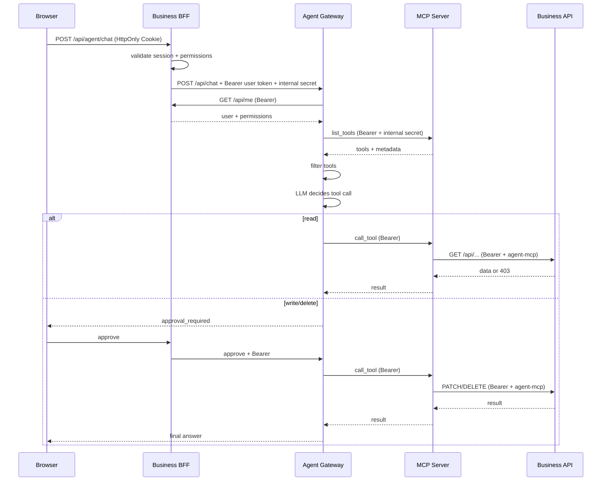

# WebAgent 架构与通用化设计

## 1. 目标

WebAgent 要解决的问题不是“做一个聊天框”，而是：

> 在不改造业务系统核心代码、不复制用户权限体系、不把数据库交给模型的前提下，让 Agent 能在现有后台里安全地调用业务能力。

因此系统被拆成三层，并且每层只有一个清晰职责：

| 层 | 职责 | 不应该做什么 |
|---|---|---|
| 业务系统 | 身份、RBAC、业务规则、数据、最终审计 | 不包含 Agent 推理逻辑 |
| MCP 工具层 | 把业务能力包装成标准工具，透传用户身份 | 不直连业务数据库，不持有超级 Token |
| Agent Gateway | 模型调用、工具过滤、审批、治理 | 不 import 业务代码，不信任前端身份 |

---

## 2. 组件

### 2.1 业务系统 `:8000`

Demo 提供：

- `POST /api/login`
- `POST /api/logout`
- `GET /api/me`
- `GET/POST/PATCH/DELETE /api/devices`
- `GET /api/devices/stats`
- `GET /api/users`
- `DELETE /api/users/{id}`
- `GET /api/audit`

关键设计：

- 浏览器使用 HttpOnly Cookie。
- 会话 Token 在数据库中只存 SHA-256 摘要。
- 每个设备接口单独检查 action code。
- `/api/agent/*` 是同源代理，浏览器不直连 Agent。
- MCP 调用业务 API 时带 `X-WebAgent-Source: agent-mcp`，审计能区分来源。

### 2.2 MCP 工具层 `:8020`

工具清单：

| 工具 | 权限 | 风险 | 说明 |
|---|---|---|---|
| `get_my_profile` | `profile:read` | read | 当前用户身份 |
| `list_devices` | `device:read` | read | 设备列表 |
| `get_device` | `device:read` | read | 设备详情 |
| `get_device_stats` | `device:read` | read | 设备统计 |
| `create_device` | `device:create` | write | 新增设备 |
| `update_device` | `device:update` | write | 修改设备 |
| `delete_device` | `device:delete` | delete | 删除设备 |
| `list_users` | `user:manage` | read | 用户列表 |

每个工具的描述尾部都有元数据：

```text
[META] permission=device:read; risk=read; category=设备 [/META]
```

Agent 解析后会把元数据从模型可见描述中移除，只用于自己的权限过滤。

MCP 服务使用 `X-Internal-Token` 做服务间鉴权。该密钥只解决“谁能访问 MCP 进程”，不解决“用户能做什么”。用户权限始终由 Bearer Token 决定。

### 2.3 Agent Gateway `:8010`

核心步骤：

```text
verify internal token
  -> verify user bearer via business /api/me
  -> choose model (admin-configured, enabled)
  -> load enabled skills
  -> list MCP tools
  -> filter by permission ∩ global switch ∩ user selection
  -> run Agent loop
  -> read tools execute immediately
  -> write/delete tools create approval
  -> approval executes with the same user token
  -> audit
```

Agent 服务同时负责管理员配置：

- 模型注册表
- 工具全局开关
- 技能
- LLM 设置
- Agent 审计

### 2.4 浏览器 UI

- 业务系统同源静态页面。
- 暗色管理台风格，三个主菜单。
- 对话界面支持模型选择、工具开关、工具调用卡、审批卡。
- 管理页支持模型、工具、技能、用户、审计、连接配置。

---

## 3. 权限传播时序



重要的不是“Agent 知道用户是谁”，而是“Agent 没有能力使用另一个身份调用业务 API”。

---

## 4. 工具注册约定

### 4.1 命名

推荐 `资源_动作`：

```text
list_devices
get_device
create_device
update_device
delete_device
export_orders
refund_order
```

避免把所有能力塞进一个 `execute_sql` 或 `call_api` 万能工具。

### 4.2 参数

- 只暴露业务需要的字段。
- 明确必填/可选。
- 对枚举值在业务 API 再次校验。
- 不接受“任意 URL”“任意 SQL”“任意脚本”。

### 4.3 风险等级

| 风险 | 审批 | UI |
|---|---|---|
| read | 否 | 蓝色读取徽标 |
| write | 是 | 黄色写入徽标 |
| delete | 是 | 红色危险徽标 + 二次确认 |

如果业务动作是“导出全部客户”“重置密码”“下线服务器”，即使技术上不是 DELETE，也应按 delete 级风险处理。

### 4.4 错误

工具错误要保留业务语义：

```json
{
  "code": "PERMISSION_DENIED",
  "message": "当前账号缺少 device:delete 权限",
  "status": 403
}
```

Agent 应把错误原样告诉用户，而不是重试到成功或绕过权限。

---

## 5. Agent loop

### 5.1 演示模式

没有 API Key 或打开演示模式时：

- 使用确定性意图识别。
- 仍然走真实 MCP 工具链。
- 仍然执行权限过滤和审批。
- 仍然写审计。

这样 Demo 在没有外部模型的情况下也能证明“权限和工具链”是正确的。

### 5.2 真实模型

真实模型使用 OpenAI-compatible Chat Completions：

1. system prompt：身份、权限、技能、边界。
2. 模型返回 `tool_calls`。
3. read 工具立即执行，把结果作为 `role=tool` 消息回填。
4. write/delete 工具暂停，生成审批对象。
5. 用户批准后执行，回填工具结果，再继续模型循环。
6. 达到最大轮次或模型返回文本时结束。

审批对象保存：

- 用户身份与 Token
- 模型
- 消息历史
- 剩余工具调用
- 已执行工具结果
- 配置和技能快照

Demo 把它放在内存中，生产应放 Redis/DB，并设置 TTL 与幂等记录。

---

## 6. 通用 Connector 的抽象

要把这套东西变成产品，建议抽象成 Connector SDK：

```python
class Connector:
    name: str
    version: str

    async def describe(self, user_context) -> list[ToolDefinition]: ...
    async def call(self, tool_name, arguments, user_context) -> ToolResult: ...
```

每个 `ToolDefinition` 至少包含：

```json
{
  "name": "update_device",
  "description": "修改设备",
  "input_schema": {},
  "permission": "device:update",
  "risk": "write",
  "idempotency": "optional",
  "tenant_scope": "current"
}
```

一个业务系统的接入产物应该是一个 Connector 包，而不是修改 Agent 核心：

```text
connectors/
  crm/
    connector.py
    tools.json
    permissions.json
    README.md
  erp/
  itsm/
```

Connector 可以是：

- REST → MCP
- GraphQL → MCP
- gRPC → MCP
- 内部 service → MCP
- 老系统 Adapter Service → MCP

无论哪种，都遵守同一原则：**最终授权由业务系统做，Adapter 不持有超级权限**。

---

## 7. 多租户与多用户

Demo 已经做到：

- 每个请求重新确认用户。
- 工具执行携带用户 Token。
- 审批绑定用户。
- 工具选择按用户存 localStorage。
- Agent 不保存跨用户记忆。

生产还需要：

- `tenant_id` 进入 Token claim 和每次工具调用。
- 审批 key 包含 tenant + user + session。
- 缓存 key、对话 key、记忆 key 全部带租户。
- MCP 工具层校验 token audience，防止跨租户重放。
- 审计按租户隔离存储。
- 管理员权限和数据域解耦，避免“平台管理员”自动等于“所有业务数据管理员”。

---

## 8. 部署与安全

推荐网络拓扑：

```text
Internet
  -> WAF / LB
  -> Business BFF (public)
  -> Agent Gateway (private)
  -> MCP Server (private)
  -> Business API (private)
```

最低安全要求：

- 浏览器不直连 Agent / MCP。
- Agent 和 MCP 只监听私网。
- 内部服务密钥使用 Secret Manager 注入，不写在镜像里。
- API Key 只存服务端，加密保存，日志脱敏。
- 用户 Token 短 TTL、可撤销、绑定 audience。
- 所有写操作审批 + 审计。
- 工具参数做服务端 schema 校验。
- 对模型输出做提示注入防护，不把业务文档里的指令当系统指令。
- 限制单用户并发、模型配额和工具调用频率。
- 审批接口防 CSRF、防重放、防跨用户。
- 对话和审计数据设置保留期与脱敏策略。

---

## 9. 产品化路线

| 阶段 | 目标 |
|---|---|
| P0（本 Demo） | 证明权限继承、MCP 工具、审批、模型/工具治理闭环 |
| P1 | Connector SDK、SSE 流式、审批持久化、工具动态注册 |
| P2 | 多租户、OIDC/SSO、配额、模型路由、可观测性 |
| P3 | Connector 市场、行业模板、评测集、提示词版本管理 |

最终形态不是“一个万能 Agent”，而是：

> 一个安全的 Agent 运行时 + 一套标准业务连接器 + 一个管理员治理台。

这样拿到任何有 API 的业务系统，开发工作主要是写 Connector 和权限映射，而不是重写 Agent。

