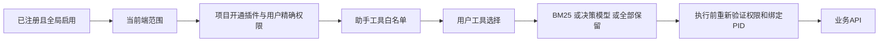

# PC4D 业务接入

本分支将 PC4D 接入集中在 `server/src/integrations/pc4d/`。框架默认不加载此连接器；开启后才注册业务身份交换、项目工具和 HTML 预览路由。正式 Chat 组件仍位于 `chat/`，本轮未修改；业务 Web、大屏和微信小程序在业务仓库实现各自界面。

## 启动和配置

在已有 `.env` 中启用：

```dotenv
WEBAGENT_PC4D_ENABLED=1
WEBAGENT_PC4D_BASE_URL=https://cloud.4dbim.vip
WEBAGENT_PC4D_PUBLIC_URL=https://agent.example.com
WEBAGENT_UI_ORIGINS=https://cloud.4dbim.vip,http://127.0.0.1:8001
WEBAGENT_PC4D_TOKEN_HOURS=2
WEBAGENT_PC4D_PERMISSION_CACHE_SECONDS=10
```

```bash
npm run build
npm start
```

`WEBAGENT_PC4D_PUBLIC_URL` 填客户端能访问的 Agent HTTPS 根地址，供小程序 HTML 预览生成绝对链接。开发时可省略，默认返回同源相对路径，由前端按 `__PC4D_AGENT__.baseUrl` 或当前页面 Origin 解析；这样 HTTPS 反向代理下不会生成 `http://` 预览地址被浏览器按 Mixed Content 拦截。小程序真机不能访问开发电脑的 `127.0.0.1`，需要配置可达的 HTTPS 地址、微信 request/upload/download 和 WebView 业务域名。业务站点同源部署可参考 `deploy/business-proxy.conf`，同时代理 `/api/agent/` 和 `/api/integrations/pc4d/`；只代理前者会导致身份交换和 HTML 预览返回 404。

`WEBAGENT_UI_ORIGINS` 是浏览器跨域来源白名单；推荐业务部署使用同源反向代理，避免多域 Cookie 和跨域流式代理问题。请求使用 Bearer 接入凭据，不依赖业务 Cookie。

首次启用自动建立三个助手：PC4D 大屏助手、Web 助手、小程序助手，并在「接入与安全」为 `screen` / `web` / `miniprogram` 各创建一个渠道接入 Token。渠道 Token 决定该端使用的助手；每个渠道取最近更新的启用 Token，停用或删除后该端立即拒绝交换。模型、语音、工具、Skill、提示词、欢迎语和预算均在管理端按助手修改。浏览器只接触 `pc4d_…` 短期凭据，不会拿到 `wa_…` 原文；短期凭据携带 `access_token_id`，每次请求重新校验 Token 是否启用、是否过期。

## 身份交换

浏览器和小程序都先交换短期凭据，再调用标准 Agent API：

```http
POST /api/integrations/pc4d/exchange
Content-Type: application/json

{"channel":"miniprogram","pid":19,"access_token":"宿主当前的业务Token"}
```

大屏请求为 `{"channel":"screen","pid":19}`，可补充 `project_name` 作为显示名称回退值。项目名称优先使用公开项目概况接口；它在部分项目上返回空名称，回退名称不会参与身份或权限判断。

成功返回 `token`、`expires_at`、`user`、`project: {id,name,logo?}`、`assistant_id`、`capabilities`。项目名称和 Logo 优先取业务项目概况接口，`project_name` 只作为显示回退值；管理端配置的品牌 Logo 只在该项目没有可用 Logo 时兜底。之后所有 `/api/agent/*` 请求携带 `Authorization: Bearer <token>`，包括流式请求、历史、附件、问答、审批、发布和运行恢复。前端应在到期前重新交换；切换项目或业务账号时丢弃旧订阅和当前界面状态，再重新交换。

服务端使用现有接口验证真实业务身份：

1. `GET /pc/api/user/info?access_token=...&pid=...`，核对返回项目与用户项目均匹配指定 PID。
2. `GET /pc/api/user/permission?access_token=...&pid=...`，取得 `module/plugin/permission/projectPlugin` 四份清单。
3. 从核验结果的 UID 或手机号生成散列 subject。客户端自行传入的手机号、openid、用户 ID 不参与认证。

接入凭据经过服务端 AES-GCM 加密认证，包含业务 Token、绑定项目、端类型、渠道 Token ID 和有效期；不写入会话、PI 上下文或工具参数。未使用账户密码为每轮对话重新登录。用户提供的测试账号仅用于本轮只读联调，不进入源码或示例配置。

## 会话、记忆和发布归属

| 场景 | 内部 owner_key | 可见范围 |
| --- | --- | --- |
| Web 和小程序，同一用户同一项目 | `pc4d:project:<pid>:user-<核验身份摘要>` | 跨端共享会话、记忆和 PagePilot 发布记录 |
| 同一用户切到另一项目 | PID 不同的 owner_key | 与上一项目隔离 |
| 公开大屏 | `pc4d:screen:<pid>:screen-project-<pid>` | 同一 PID 的所有大屏访客共享 |

业务账号目前可提供可验证的手机号，框架使用其摘要保持两端一致。手机号变化时需要业务开发提供稳定 UID 或迁移映射；openid 只有在服务端完成账号绑定后才能作为别名，不能直接信任前端缓存。

公开大屏按项目共享意味着该项目访客可见同一份历史和发布记录，不代表私人账号。大屏与真实用户身份完全隔离。用户端默认使用自己的端助手，同时仅允许访问 Web / 小程序两个已配置助手，以便继续另一端发起的历史会话；实际工具权限仍根据当前端和当前业务登录重新计算。

原有文件会话与清理机制保持有效：聊天正文、附件引用和 PI entries 在 `data/sessions/`，SQLite 保存运行元数据和归属；会话保留期取管理端配置。发布记录只查 WebAgent 本地 owner 记录，不通过 PagePilot 全局 Token 拉取其他项目页面。

## 工具目录和权限

默认工具模板为 `server/src/integrations/pc4d/catalogue.json`；首次启动复制到 `data/tools/pc4d/catalogue.json`，运行只读取数据目录。以后升级不会覆盖人工维护的目录。新增或删除工具后重启后端；已有工具的启停、标签、用户可见/可选策略可直接在管理端维护。

所有调用都使用原生 `ToolSpec.execute()` 包装业务 HTTP 查询，不额外搭建 MCP 服务。工具目录只保存路径、参数 Schema、说明、端范围和权限映射。API 根地址由部署配置控制，业务 Token 和 PID 由执行上下文注入，模型不能提供或覆盖这些值。请求执行前检查必填项、类型、枚举、长度、正则及数值上下界，分页使用 Schema 的默认值；不允许将任意模型参数直接转发业务服务。响应递归去除手机号、Token、播放配置等字段，外部资源地址不进入模型上下文。

过滤顺序：



BM25 和决策模型只筛相关性。它们只会看到已授权候选；不能把关闭功能、其他项目或无权限工具重新选回来。二者互斥且可都关闭，沿用管理端已有配置。本次没有自动修改筛选开关。

首批开放审核过的只读大屏数据接口，统一带「大屏数据」标签。普通 Web 和小程序先提供项目上下文、日期时间、交互问答及管理员配置的 PagePilot；业务写入、审批、设备控制等接口需要继续按业务域确定动作与权限映射，未因 Swagger 存在就自动暴露。完整分组与本批清单见 [API 盘点](PC4D-API-INVENTORY.md)。

工具数量不等于每轮都要把全部 Schema 交给主模型。几十个候选时可启用已有的 BM25 延迟发现，或使用决策模型筛选；没有配置时仍按实际授权集合工作，不会悄悄启用额外模型。筛选减少上下文负担，但不能替代前面的功能和权限过滤。三个助手可以复用同一个原生工具实现，不必为了三个端复制三套业务请求。

新增用户侧只读工具可在 JSON 中配置精确权限：

```json
{
  "name": "pc4d_beam_tasks",
  "title": "制梁任务列表",
  "description": "查询当前项目的制梁任务，可按起止时间筛选。",
  "path": "/pc/api/beam-production-task/list",
  "channels": ["web", "miniprogram"],
  "tags": ["PC4D", "制梁任务"],
  "parameters": {
    "type": "object",
    "properties": {
      "page": {"type":"integer","description":"页码，起始为1"},
      "count": {"type":"integer","description":"每页条数，最多100"}
    },
    "additionalProperties": false
  },
  "permission_alternatives": [
    {"channel":"web","plugin":"pc4d-web-beam-production-task","permission":"f-pc4d-web-beam-production-task-view"},
    {"channel":"miniprogram","plugin":"pc4d-wechat-beam-production-task","permission":"f-pc4d-wechat-beam-production-task-view"}
  ]
}
```

示例需要逐项核对目标项目真正返回的权限码，并把新工具加入对应助手白名单。`plugin` 必须同时存在于用户可用插件和项目已开插件中，`permission` 使用精确动作码；不能用「有这个模块」推断能修改、删除或审批。默认连接器始终使用 GET；写操作应另写明确风险、Schema、权限和幂等策略的 ToolSpec，再复用框架审批机制。

Swagger 中有 GET 写操作，例如重新生成计划、修改计划天数、关联审批结果；不能按 HTTP 方法批量导入为只读工具。账号登录、Token 刷新、权限管理、示范数据重置、导入导出、设备开关也不在默认工具清单。

## HTML 和 PagePilot

正文按 Markdown 增量渲染，完整 HTML 使用紧凑产物卡。需要在微信 WebView 打开时：

```http
POST /api/integrations/pc4d/artifacts
Authorization: Bearer <接入凭据>
Content-Type: application/json

{"html":"<!doctype html>...","title":"项目报告","session_id":"s_..."}
```

返回 30 分钟有效的同源相对 `url`（配置 `WEBAGENT_PC4D_PUBLIC_URL` 时才返回绝对地址）和 `path`。业务前端预览直接用 `iframe srcdoc` 渲染内存中的 HTML，不依赖该 URL，因此 HTTPS 反向代理下不会被 Mixed Content 拦截；`url` 只用于「新窗口打开」。HTML 临时保存在 `data/artifacts/pc4d/`，每小时清理超过一小时的文件，不往数据库写正文，也不被会话附件的孤儿清理误删。链接是预览能力凭证，未携带业务 Token；预览通过 CSP sandbox 隔离脚本，禁止读取接口、Cookie、嵌套页面和提交表单。持久公开分享使用 PagePilot，临时链接不作为发布记录。

发布、更新、列表沿用 `/api/agent/pagepilot/publish`、`/api/agent/pagepilot/publications`。每次发布询问标题、可见范围和可空密码；不自动生成密码。发布成功后前端立即弹出可复制 / 可直接打开的链接；内容已发布但密码或可见范围更新失败时返回 `partial`，仍展示已生成的链接并保留原表单供原地重试。更新必须提交当前 owner 的 `publication_id`，不能用全局 Token 查询或更新别人的页面。

语音入口按管理员配置决定是否渲染：输入框语音默认使用文件 STT（录完一次识别），只有「输入框识别策略」明确设为 `realtime` 才在录音过程中回填；右上角实时语音通话始终使用实时 STT/TTS，并在 LLM 输出过程中逐句合成朗读，不等待整段回答结束。任何语音模型未配置时，对应按钮不显示。

## 业务端代码与后续计划

| 代码位置 | 本次接入 | 部署配置与说明 |
| --- | --- | --- |
| 业务平台 `react/src/components/PCAgentChat/` | 大屏浅色弹窗、普通 Web 入口；独立于框架 Chat | `window.__PC4D_AGENT__.baseUrl` 或同源代理，详见该仓库 `react/docs/` |
| 小程序 `cbim_wechat/components/pc4d-agent/` | 在已有原生组件中接身份、会话、流式、图片、语音输入、朗读和发布 | `cbim_wechat/config/webagent.js`，详见该仓库 `docs/AI助手接入.md` |

建议按以下顺序继续，不直接发布剩余的全部接口：

1. **只读大屏试运行**：大屏渠道由「接入与安全」中的渠道 Token 绑定，框架不存在 PID 白名单，任意正整数 PID 都能换取该渠道的短期凭据；业务数据接口仍会按当前绑定项目校验。请确认默认对话模型、候选工具、项目共享历史与发布的可见范围符合实际业务。公开大屏不构成用户登录，正式公网部署应在业务网关设置项目范围、模型预算及限流。
2. **确定首批用户业务域**：由业务方选择制梁任务、质量、库存、发货等优先领域，逐项确认真实请求参数、结果字段、项目功能码和用户动作码。以任务语义封装 Tool，而不是机械地“一条接口一个工具”。
3. **先查询后写入**：每个领域先验收只读工具；新增、修改、审批、删除另行确定确认流程、幂等、取消后的状态查询和审计要求。
4. **用户端分角色验收**：至少覆盖有功能有权限、项目未开功能、用户无动作权限、切换项目、过期登录和跨端继续会话，保证无权限工具既不进入候选，也不能被直接执行。

微信实时通话本轮未移植，不以普通录音识别冒充实时通话。小程序语音输入使用客户端原生 WAV，识别后填入输入框；TTS 按正文分句朗读。原生页面布局、录音与 WebView 的最终效果需要真机验收。

## 二次 Review 修复

- 工具目录按文件修改标记缓存，避免一次候选工具查询反复解析同一份 JSON；目录变化后失效，新增工具仍需重启注册。统计结果 `0` 和状态值 `false` 原样保留，不转成空对象。
- Web / 大屏打开历史时恢复该会话的模型和上下文上限；助手固定模型优先于历史选择。首次发送创建会话不重置输入框中已选的模型。
- 空闲聊天重新打开及新建对话时刷新管理员工具策略、助手配置和模型元数据。运行中的聊天不因打开窗口而重建订阅或重置模型。
- Web 流式事件按事件 ID 去重；创建会话失败时恢复草稿和附件。问答取消使用 JSON 响应，提交失败保留原交互卡片供重试。
- Web / 小程序兼容 ECharts、常见 Chart.js 配置和 `labels + series` 简写，不把简写直接交给错误的图表库。
- 小程序输入长度与后端统一为 20,000 字符；固定模型不被本地偏好覆盖，默认推理与确认模式遵循助手配置。文件 / 实时 ASR 可用状态按实际输入模式判断，不把两种开关混为一谈。
- 小程序录音、麦克风授权等待及识别期间不再追加自动朗读，避免语音回录。长历史分批送入 `setData`，展开过程限制展示详情量；超长正文保留完整内容，通过预览卡查看，不将正文全文截断丢弃。
- 小程序已发布页面通过当前用户的本地发布记录生成 Agent 域名下的隔离预览，提供独立的“复制链接”用于分享，不强依赖 PagePilot 域名或非标准端口能直接进入微信 WebView。预览不改变原页面的密码和公开设置。
- HTML 临时预览增加 `no-store` 和 `nosniff` 响应头，避免浏览器缓存绕过预览链接的过期检查。

自动化回归不等于生产零缺陷保证。真实微信布局、麦克风、合法域名、真实模型及 PagePilot 发布仍按下述验收范围单独确认；未审核的普通业务写入接口保持关闭。

## 三次 Review 修复

- 图片预览与 PI 图片加载共同校验会话目录、真实文件路径和大小，拒绝通过符号链接跨会话读取；历史图片响应使用 `private, no-store`，避免切换账号后仍读取浏览器缓存。
- 人机问答拒绝空回答时保留待回答状态；运行中不能重复提交或取消另一条问题，避免先改状态再失败。
- 业务 Web / 大屏补齐历史重命名、删除，以及消息修改、删除和分叉；危险操作需要确认，运行或加载期间禁止冲突操作。运行完成后同步后端消息 ID，刚生成的消息也能使用这些操作。
- 历史成功加载后才切换当前会话，失败保留原会话；明确的 HTTP 发送拒绝恢复输入草稿，网络结果不确定时不盲目重发 POST。初次初始化期间新建对话不会卡住。
- Web 和小程序的发布草稿、编辑和删除确认绑定发起时的会话与身份；迟到的请求不能回填其他会话。PagePilot 部分成功保留可修正表单和已创建页面 ID，重试更新同一页面而不是重复发布。
- 助手的默认确认模式被正确应用；切换历史清空旧草稿附件。窄屏、横屏和减少动效偏好均纳入业务组件浏览器回归。
- 管理端九个菜单及 375px 手机视口完成隔离冒烟检查，无页面异常或横向溢出；这不等于所有管理表单都完成真实供应商端到端验收。

## 验证

```bash
node --import tsx --test server/test/pc4d.test.ts
npm run typecheck
npm test
npm run build
```

集成测试覆盖身份交换、伪造输入拒绝、失效凭据、跨端共享/跨项目隔离、精确权限与项目功能交集、停用后不进上下文、执行前重验、PID 不可覆盖、SSE CORS、真实 PI 工具循环、隔离预览以及 PagePilot 本地归属。测试使用本地协议 Mock，不会改动真实业务数据。

2026-11-17 使用授权测试账户在 PID 19 完成真实只读联调：Web / 小程序身份交换成功，核验后 owner 相同；台座、产能、张拉及压浆工具均返回业务结果。没有调用写入接口，也没有向生产配置中保存测试账户或 Token。协议与隔离测试使用本地 Mock 覆盖 PI 模型工具循环，不将其描述为真实供应商的验收。

三次 Review 后，框架全套类型检查、构建和 106 项测试通过（后端 74、SDK 4、Chat 28）。浏览器还验证了业务真实聊天组件到隔离测试后端的流式链路、图表和 HTML 预览；该链路使用本地 Mock 模型，不消耗真实模型额度。业务平台的旧 Umi 工程在 Node 26 下存在 `http_parser` 依赖兼容问题；使用其已有 Node 16.9.0 环境完成了全量生产构建验证（14,094 模块）。这只是旧业务工程的兼容验证，不建议新的 Agent 后端使用已停止维护的 Node 16；后端版本要求仍以框架 README 为准。

业务 React 的 26 项单元、14 项 Chromium 交互测试通过；新增组件使用业务工程自带的 TypeScript 4.9.5 检查通过，没有要求整个业务工程升级 TypeScript。新增图表类型依赖通过业务仓库的 Yarn resolution 锁定兼容版本，安装时应使用该仓库的锁文件。

小程序 31 项协议与组件专项测试、微信依赖产物构建通过；测试涵盖账号切换期间不跨身份发送旧草稿和图片，以及长历史、固定模型、语音开关、录音防回录、发布内容的同源预览、历史切换失败和迟到确认的保护。仍需使用真实模型、微信开发者工具及手机完成真机验收。

微信原生布局、录音授权、合法域名和真机 WebView 需要在开发者工具及真机验收；Node 测试不能替代这些验证。
